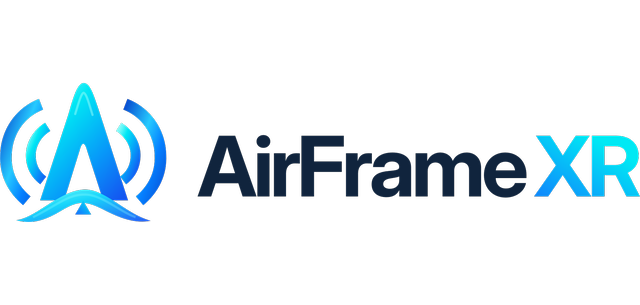

<p align="center">
  <picture>
    <source media="(prefers-color-scheme: dark)" srcset="docs/images/logo-dark.png">
    
  </picture>
</p>

# VisionALVR

**Stream PC VR games to any ALVR headset, without SteamVR, through one lean NVIDIA-accelerated chain, with frame generation built in.**
Made for the Apple Vision Pro and 90 Hz; tested on the Quest 3 too.

VisionALVR replaces the SteamVR + ALVR server pair on the PC with a single streamer of about 20 MB: an OpenXR runtime, a compositor shim and
the ALVR protocol in one process chain, written for NVIDIA GPUs end to end. Because it owns the whole path from the game's swapchain to the
Wi-Fi packet, every stage is tuned against the next one instead of stacked mods negotiating through SteamVR:

- **No SteamVR.** The game talks OpenXR to a small runtime; no SteamVR compositor, no extra frame copies between processes, no dashboard.
- **NVIDIA all the way.** NVENC HEVC 10-bit with split-frame encoding across the GPU's encoders, ALVR's foveated encoding when you want it,
  NVIDIA Optical Flow for the generated frames, and the game's own **DLSS motion vectors** when the
  [VisionALVR-OptiScaler](https://github.com/jfbobier/VisionALVR-OptiScaler) DLL sits in the game folder. Shared GPU memory between the
  game, the shim and the encoder; nothing crosses the CPU.
- **Frame generation that is part of the pipeline, not a mod on top of a mod.** The game is paced to 1/3, 1/2 or 2/3 of the display rate and
  the streamer interpolates the rest, every output rotated to the newest head pose. On an RTX 5090 and a Vision Pro: a 40 fps Unreal game
  streams at the panel's 90-100 Hz with 0.5-2 % of the headset's periods repeated and 67 ms of total latency, against 40-50 % repeated and
  86 ms without it. A per-game record proposes the rate that held last time, on this headset.
- **Every ALVR client.** The headset sees an ordinary ALVR 20.14 server: the stock ALVR app on the Vision Pro, the Meta-store client on the
  Quest, the others untested but expected to work. Focus and tuning: the Vision Pro at 90 Hz.
- **Lean by design.** One zip, no installer, no registry beyond the OpenXR runtime registration (undone by a script), a settings file you can
  read, a launcher that proposes from measurements and never decides for you.

> [!WARNING]
> **ALPHA SOFTWARE (0.4): TEST AT YOUR OWN RISK.**
> On real headsets it has been tested by one person, on one PC (RTX 5090) with one Vision Pro and one Quest 3, frame generation included
> (plus automated tests on a laptop GPU). Games may crash, fail to start, or show a broken image; the stream may stutter or have high latency. It changes your PC's OpenXR runtime registration and adds a firewall rule
> (both undone by `unregister_openxr_runtime.bat`). Keep comfort in mind: a frozen or juddering image in a headset can cause
> discomfort; take the headset off if anything looks wrong. Provided "as is", without warranty of any kind (see [LICENSE](LICENSE)).

**Main focus:** the **Windows** streamer on an **NVIDIA** GPU (RTX 40 series or newer recommended; any NVENC 12.2 driver runs), with the **ALVR app (20.14.x) on
Apple Vision Pro**. That is what is built, tuned and tested here.

This is a **personal project**. It targets NVIDIA because that is what I run, and the Vision Pro because that is my headset.
It is not affiliated with or supported by NVIDIA, Apple or the ALVR project.
- **Other headsets**: the ALVR protocol is device agnostic, so **other headsets with an ALVR client (Quest, Pico, ...) are expected to
  work**. The Quest 3 has been tested here with the Meta-store ALVR client, frame generation included; others are not, and the encoder
  settings, defaults and the idle chroma-key frame are tuned for the Vision Pro. Reports and small fixes for them are welcome, with no
  promise of an answer or a fix; nothing that makes the Vision Pro path worse will be merged.
- **A plain green screen when the headset connects is normal and intended**: it is the streamer's idle frame while no game runs. On the
  Vision Pro set the ALVR app's **chroma-key colour to pure green (#00FF00)** and the green becomes transparent: you see your room between
  games and the game appears when it starts. If the headset stays green, the chroma key is not set. VisionALVR does not mirror the Windows
  desktop into the headset between sessions (Virtual Desktop's way) by design: see-through is the cleaner idle state.
- **AMD / Intel GPUs**: not supported and not planned. The encode path is NVENC only; you are welcome to fork and adapt it.
  [ALVR](https://github.com/alvr-org/ALVR) itself supports them.

This project **does not aim to compete with existing commercial applications**. It offers **more options to the VR community**, using the
already open source [ALVR](https://github.com/alvr-org/ALVR) as the infrastructure.

> [!NOTE]
> **Game compatibility is not the goal.** VisionALVR is a lean, low-latency path for the games that work with it; it does not aim
> to run every VR game. **For a game that does not work, use SteamVR + ALVR**: SteamVR is excellent at compatibility and at
> configurability, and this project does not try to compete with that. In testing, the vast majority of **UEVR games**, the
> **Luke Ross mods** and **native OpenXR / VR games** worked, but some games still have controller problems, crashes or both.
> Not supported: SteamVR/OpenVR-only games (they need SteamVR).

VisionALVR replaces the SteamVR + ALVR server pair on the PC with one lean streamer. It speaks the ALVR 20.14.1 protocol
unchanged, so the ALVR app on the headset sees an ordinary ALVR server. In between, it does less work:
no SteamVR compositor, no extra frame copies between processes, and an encode path written for NVENC only.

```
OpenXR game
  -> VirtualDesktop-OpenXR (VDXR, OpenXR runtime, small patches)
  -> OVRShim (LibOVRRT64_1.dll: composes layers into a shared 10-bit side-by-side frame ring)
  -> alvr_host.exe (ALVR v20.14.1 server_core + ALVR's own foveated encoding + NVENC HEVC 10-bit)
  -> ALVR protocol over Wi-Fi
  -> ALVR app on Vision Pro (stock, from the App Store)
```

## Status
- **Works on the real headset** (tested on RTX 5090 + Vision Pro, and on a Quest 3 with the Meta-store ALVR client): the vast majority of
  UEVR games, Luke Ross mods (Dead Space Remake), native VR games, controllers (ALVR's Quest/Touch emulation), haptics, game audio,
  discovery/pairing with the stock app.
- **Known issues**: some games still have controller and/or crash issues (for example one Unity game crashes, one UEVR game shows
  no image, one Unity game shows its menu very small). Use SteamVR + ALVR for those. Games running elevated (e.g. Cemu) cannot
  reach the streamer.
- **New in 0.3**: a **setup wizard** (`configure.exe`) that reads what the headset supports, offers a community profile, a pre-filled
  manual configuration or your existing ALVR settings, then tests the result (system and NVENC, encoder speed, network at the configured
  bitrate, a real scene streamed through the pipeline with the headset's own head pose, audio); **Find headset...** in the streamer window;
  any NVIDIA GPU with NVENC API 12.2+ (the RTX 40 check is gone); frame pacing with an intake gate and a three-deep in-order queue;
  the Vision Pro profile defaults to foveated encoding at 300 Mbps. The "low"/"auto" latency modes were removed (they dropped 15-30 % of
  frames in GPU-bound games).
- **Vision Pro known issue**: in heavy games 5-10 % of frames carry the same tracking timestamp as the previous one and the headset skips
  them (shown fps a little under the host fps). A fix exists (branch `exp/restamp-2026-10-13`) but needs a change on the visionOS
  client side, so it is not in the release.
- **New in 0.4: frame generation** (toggle in the streamer window and in Settings, `video.frame_gen`, off by default): for games that cannot
  hold the display rate. A slider sets the game's rate as a fraction of the display rate, **1/3, 1/2 (default) or 2/3**, and the streamer
  generates the frames in between: at 1/2 and 1/3 the game is locked to the display cadence (one or two generated frames per rendered one),
  at 2/3 it is held to two thirds of the rate and every frame sent is interpolated. In-scene motion comes from the game's own **DLSS motion
  vectors** when the [VisionALVR-OptiScaler](https://github.com/jfbobier/VisionALVR-OptiScaler) DLL sits next to the game's executable
  (download it from that repository's Releases page, rename it `dxgi.dll`, tick *DLSS motion vectors*), else from the GPU's optical-flow
  engine (NVIDIA Optical Flow, Turing or later). Every output is rotated to the newest tracking sample. Verified on a Vision Pro at 100 Hz
  with an RTX 5090: missed display periods 38 % -> 1 % at half rate; also run on a Quest 3. Costs latency by construction (interpolation:
  one game period); small fast objects may ghost without vectors. The rate is fixed for a run; a **Recommended** tick sets it from the
  game's recorded runs on the connected headset (`config/games.json`, written by the streamer at every game end: fps, the headset's repeated
  periods, the streamer's repeats), and the streamer window shows the last run's record when a game ends. A **Recenter** button (also sent
  at every game start) turns the tracking space to your current forward. See [docs/FRAME_GENERATION.md](docs/FRAME_GENERATION.md),
  [docs/FRAME_GENERATION_UNCAPPED.md](docs/FRAME_GENERATION_UNCAPPED.md) and [docs/MOTION_VECTORS.md](docs/MOTION_VECTORS.md). Not automatic
  by design: a game that holds a steady 70-75 fps is often better left alone.
- The benchmark that picks settings for your PC + router + headset is half built: the headless quality sweep works
  (`docs/BENCHMARK_DESIGN.md`); the headset phases and applying the results are next.
- Measured on a 1-NVENC laptop GPU and a 5090. Multi-engine split encode is wired in but not yet active in `auto` mode.

`docs/progress.md` is the detailed log: what is built, what is tested (and how), what is not.

## Requirements
- Windows 10/11, an **NVIDIA** GPU with a current driver (NVENC API 12.2+); RTX 40 series or newer recommended (several NVENC chips enable split encoding).
- Apple Vision Pro with the **ALVR** app (20.14.x), PC and headset on the same LAN (Wi-Fi 6 on 5 GHz for the first Vision Pro; 6 GHz is for newer models and Quest 3). Other headsets with an ALVR client: see above.
- SteamVR and ALVR's own launcher closed while streaming (same ports).

## Recommended network setup
The stream is 100+ Mbit/s of low-latency video: the network matters more than the PC. What works best:
- **A Wi-Fi 6 (or newer) router dedicated to the headset**, in the same room (line of sight if you can). The first Vision Pro (M2) has
  **Wi-Fi 6 on 5 GHz only (no 6 GHz)**: use the 5 GHz band with a **160 MHz channel**. A 6E/7 router is fine, and the 6 GHz band is for
  newer Vision Pro models and the Quest 3. Put it in **dumb access point mode** (router functions, NAT and its own DHCP server off), wired
  by Ethernet to your main router or switch, so the headset stays on the same subnet as the PC and no second NAT adds latency.
- **PC on Ethernet** (not Wi-Fi), on the same network as the access point.
- **A fixed IP for the headset**: a DHCP reservation on your DHCP server (usually the main router) bound to the headset's **MAC address**.
  In visionOS, set *Private Wi-Fi Address* to Off (or Fixed) for this network, otherwise the MAC address can change and the reservation
  stops matching. A fixed address makes pairing and reconnecting reliable.
- Nothing else heavy on that access point while you play (downloads, other headsets).

## Install (users)
Download the release zip, unzip it anywhere, run `register_openxr_runtime.bat` once, then `configure.exe` (pair the headset,
benchmark, settings) and `VisionALVR.exe` (keep it open while you play). Details, settings and logs: [docs/INSTALL.md](docs/INSTALL.md).
The headset's address does not have to be fixed: VisionALVR dials the saved address, finds a paired headset again by name on its own,
and the **Find headset...** button in its window searches the network, pairs a new headset or takes an address you type.
`configure.exe` offers a shared **community profile** for your headset (JSON files, import/export, see [docs/HMD_PROFILES.md](docs/HMD_PROFILES.md); the
starter Quest and Pico profiles are not verified yet), a manual configuration or your existing ALVR configuration, then tests the result on your PC and network.

## Build from source (contributors)
VisionALVR builds **on Windows only** (MSVC, the Windows SDK and NVENC; cross-compiling from Linux is not supported). With the
prerequisites installed ([docs/DEVELOPMENT.md](docs/DEVELOPMENT.md): Git, Rust, CMake, LLVM, NuGet, Visual Studio 2022 with C++,
all available through `winget`, plus an NVIDIA driver):
```powershell
git clone https://github.com/jfbobier/vision-alvr.git
cd vision-alvr
powershell -ExecutionPolicy Bypass -File build.ps1
```
The first run fetches ALVR v20.14.1 and VirtualDesktop-OpenXR at pinned commits and builds them (10+ minutes, ~6 GB); the
result is the same portable folder and zip as the release, in `out\dist\`. An automated test harness (end-to-end scenarios with
a headless mock ALVR client, no headset needed) is described in [harness/README.md](harness/README.md).
See also [CONTRIBUTING.md](CONTRIBUTING.md).

## Repository layout
| Path | What |
|---|---|
| `tools/host/` | `alvr_host` (Rust): ALVR server_core embedded, encoder loop, pacing, benchmarks, logging |
| `nvenc/hostlib/` | C++ library of the host: NVENC wrapper around ALVR's encoder, IPC, QP map, benchmark renderer + quality metric |
| `nvenc/upstream/` | ALVR's encoder sources, vendored **unmodified** (checksums in `nvenc/upstream.sha256`; patched at build time by `tools/host/build.rs`) |
| `ovrshim/` | OVRShim: the LibOVR-side driver loaded by VDXR (fork of VDXR's OVRNull): layer composition, frame ring, IPC |
| `tools/gui/` | `VisionALVR.exe` (runtime window) and `configure.exe` (pairing, benchmarks, settings), C# WinForms |
| `tools/install/` | portable-folder scripts (OpenXR runtime registration), shipped default session |
| `tools/mock_client/` | headless ALVR client (Rust, ALVR's client_core) used by the harness |
| `tools/probe/` | `xr_probe`: OpenXR test app (layers, input, pacing) |
| `tools/bench_scene/` | offline converter of the benchmark scene (glTF + Draco -> `.vab`) |
| `tools/patches/`, `tools/remote/` | the one ALVR patch (test-only loopback binding), PowerShell build/test stages run on the builder |
| `harness/` | test harness (Python, stdlib only): scenarios, checks, builder orchestration |
| `third_party/` | vendored headers (cgltf, stb_image) and licence texts |
| `docs/` | install guide, benchmark design, progress log |

## Relationship to upstream (how much is forked)
Nothing is a long-lived fork: ALVR and VirtualDesktop-OpenXR are fetched at pinned upstream commits (`deps.lock.json`) and
built with small, asserted patches, so an upstream change fails loudly instead of drifting.
| Upstream | How it is used | Changes |
|---|---|---|
| **ALVR v20.14.1** (Rust) | `server_core`, protocol, sockets, audio, session crates linked into `alvr_host` as a workspace member; client_core in the test client | one patch, 26 changed lines (`tools/patches/loopback-client.patch`): lets the test client bind its own loopback address; inactive unless `ALVR_BIND_IP` is set (it is compiled into `alvr_host.exe` through the shared `sockets` crate) |
| **ALVR encoder C++** (`VideoEncoderNVENC`, `NvEncoder*`, foveated encoding `FFR`, ~3,900 lines + NVIDIA's header) | vendored **unmodified** in `nvenc/upstream/` (checksums) | about 20 asserted build-time text replacements in `tools/host/build.rs`: 10-bit texture format, NVENC SDK 12.2 field names, a struct initializer the newer SDK broke, real error messages, split-frame encoding, QP delta map, reconstructed-frame output, accessors and a config dump |
| **VirtualDesktop-OpenXR** (the OpenXR runtime) | built from upstream at a pinned commit | 2 text patches + 1 define at build time (`tools/remote/stage15_vdxr.ps1`): per-eye visibility on quad/cylinder/cube layers in "Oculus runtime" mode, all 6 faces of cube swapchains, advertise the cube-layer extension |
| **VDXR's OVRNull** (sample "null" LibOVR driver) | `ovrshim/` = OVRShim, the one real fork | `driver.cpp` grew from 793 to ~1,850 lines (~1,190 new or changed), 6 new files (IPC, layer shaders); OVRNull's other ~1,570 lines are used unchanged |

Everything else is new code (~11,000 lines): the host (`tools/host`, Rust), the encoder library and benchmark
(`nvenc/hostlib`, C++), the GUIs, the installer scripts, the mock client, the OpenXR probe and the harness.

## Credits
VisionALVR stands on two projects that did the hard work:
- **[ALVR](https://github.com/alvr-org/ALVR)** (MIT) by polygraphene and the alvr-org contributors: the foundational
  infrastructure this is built on, its streaming protocol, server core, networking, audio, foveated encoding and NVENC
  encoder code, and the [ALVR visionOS client](https://github.com/alvr-org/alvr-visionos) that runs on the headset.
  VisionALVR exists because ALVR made wireless PC VR open.
- **[VirtualDesktop-OpenXR (VDXR)](https://github.com/mbucchia/VirtualDesktop-OpenXR)** (MIT) by Matthieu Bucchianeri and its
  contributors: the excellent, highly optimized OpenXR runtime every game here runs on; OVRShim started as its OVRNull sample.
  Thanks also for the many other OpenXR tools from the same author that the PC VR community relies on.
- **[OFXR-Bridge](https://github.com/tig3rmast3r/OFXR-Bridge)** (MIT) by tig3rmast3r: the frame-generation synthesis recipe
  (rotation-compensated residual flow, midpoint sampling, confidence and crossfade fallback) and its never-block safety rules were
  studied from its code and re-implemented here; its DLSS provider interface is the model for ours.
- **[OptiScaler](https://github.com/optiscaler/OptiScaler)** (GPL-3.0) and its contributors: the DLSS motion-vector tap for frame
  generation is a separate fork, [VisionALVR-OptiScaler](https://github.com/jfbobier/VisionALVR-OptiScaler), kept under GPL-3.0 and
  shipped as its own DLL; VisionALVR talks to it only through shared textures and a small documented interface. Years of
  game-compatibility work live in that project.
- NVIDIA Video Codec SDK and Optical Flow SDK headers (MIT). cgltf (MIT), stb_image (public domain / MIT), Draco (Apache-2.0, offline converter only).
- Benchmark scene: "Littlest Tokyo" by Glen Fox ([glenatron](https://sketchfab.com/glenatron)), CC-BY-4.0, converted and placed
  in a textured room.

Details: [THIRD_PARTY_NOTICES.md](THIRD_PARTY_NOTICES.md). VisionALVR is not affiliated with or endorsed by the ALVR project,
Apple, NVIDIA, Virtual Desktop, OFXR-Bridge or OptiScaler. Apple Vision Pro and visionOS are trademarks of Apple Inc.

## License
MIT, see [LICENSE](LICENSE). Third-party components keep their own licences ([THIRD_PARTY_NOTICES.md](THIRD_PARTY_NOTICES.md)).

## Documentation

- [docs/ARCHITECTURE.md](docs/ARCHITECTURE.md): the frame pipeline, its threads and buffers (v0.2, extended in 0.3)
- [docs/FRAME_GENERATION.md](docs/FRAME_GENERATION.md): frame generation (0.4): half-rate pacing + interpolated frames; [docs/FRAME_GENERATION_UNCAPPED.md](docs/FRAME_GENERATION_UNCAPPED.md): the uncapped mode, cap and lag, headset-night verdicts; [docs/MOTION_VECTORS.md](docs/MOTION_VECTORS.md): the DLSS motion-vector tap (OptiScaler fork) and synthesis from vectors
