<p align="center">
  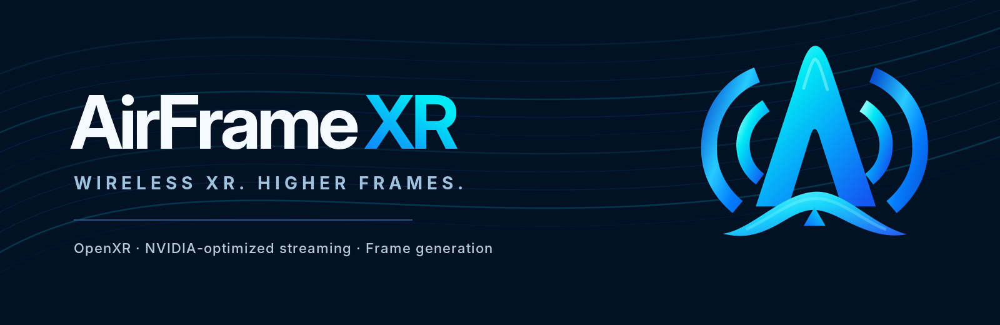
</p>

<!-- AirFrameXR overview: editorial refresh -->
# AirFrameXR

**Wireless PCVR, re-engineered for NVIDIA. No SteamVR required. Optional integrated frame generation.**

AirFrameXR replaces the **SteamVR + traditional ALVR PC streamer** with a **lean, NVIDIA-optimized OpenXR runtime and streaming pipeline**. It handles frame pacing, optional frame generation, NVENC encoding, and wireless delivery together, instead of layering those components on top of SteamVR.

**The headset side stays the same:** AirFrameXR speaks the **ALVR v20 protocol**, so you keep the existing ALVR headset client. The Windows streamer is NVIDIA-only; it has been tested on **Apple Vision Pro** and **Meta Quest 3**. Other ALVR-protocol clients may work, but are not verified here.

<p align="center">
  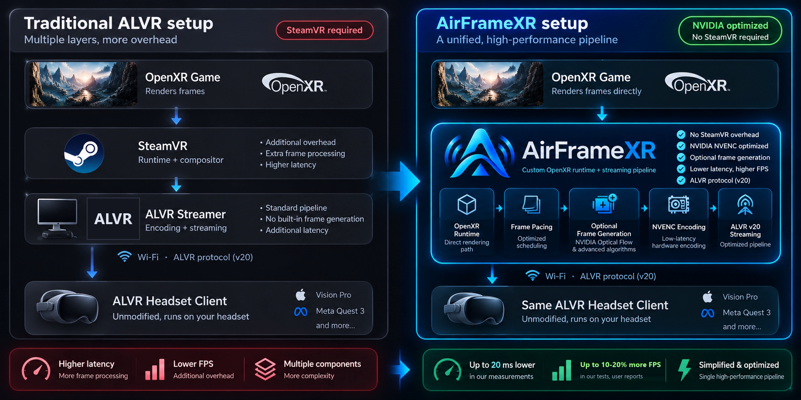
</p>

### The difference at a glance

| | Traditional PC-side ALVR setup | AirFrameXR |
|---|---|---|
| Runtime | SteamVR runtime and compositor | Dedicated OpenXR runtime based on VirtualDesktop-OpenXR (VDXR), with OVRShim |
| Streaming | Separate ALVR PC streamer | Integrated streaming pipeline using ALVR server components and protocol v20 |
| Encoding | General-purpose ALVR configuration | NVIDIA-specific NVENC HEVC 10-bit path |
| Frame generation | Requires a separate approach if desired | Optional, built into the frame pipeline with NVIDIA Optical Flow and edge-aware synthesis |
| Headset | ALVR client | **Same ALVR client — no custom headset app required** |
| Compatibility priority | Broad SteamVR ecosystem | Lean OpenXR-first path; **SteamVR/OpenVR-only titles are not supported** |

### Why build it this way?

- **Remove SteamVR from the PC streaming path.** OpenXR games use a small runtime without the SteamVR compositor or extra inter-process frame copies.
- **Optimize end to end for NVIDIA.** A shared-GPU-memory path, low-latency frame pacing, NVENC HEVC 10-bit encoding, and ALVR-compatible networking are tuned together.
- **Make frame generation native to the streamer.** Optional GPU optical-flow interpolation and edge-aware synthesis can improve displayed smoothness when a game cannot sustain the headset's refresh rate. This feature is experimental and **can add interpolation latency**; it is not a free FPS boost.
- **Keep it simple.** Portable distribution, readable settings, targeted tools, and no attempt to be a general-purpose SteamVR replacement.

### Performance: measurements, not promises

**In the maintainer's tests of the new pipeline, gains of up to 10-20 % more FPS and up to about 20 ms lower latency were observed** in some games compared with the earlier SteamVR + ALVR path, and users report similar numbers (for example Enshrouded: about 45 fps here against 35-40 with SteamVR, on one user's own reading). These are observations from tested configurations, **not guaranteed gains**: they vary with the game, headset and network, and in some setups the two paths are at parity. Frame generation should be evaluated separately: it improves delivered/displayed cadence in some GPU-bound cases, but has its own latency trade-off. See the performance findings and testing harness below for technical context.

> **Scope:** Windows + NVIDIA GPU + compatible OpenXR games. Keep using the ALVR app on your headset. For SteamVR/OpenVR-only games or maximum compatibility, use SteamVR + stock ALVR instead.

<!-- End AirFrameXR overview -->

> [!WARNING]
> **VERSION 1.1 (PRE-RELEASE): TEST AT YOUR OWN RISK.**
> On real headsets it has been tested by one person, on one PC (RTX 5090) with one Vision Pro and one Quest 3, frame generation included
> (plus automated tests on a laptop GPU). Games may crash, fail to start, or show a broken image; the stream may stutter or have high latency. It changes your PC's OpenXR runtime registration and adds a firewall rule
> (both undone by the launcher's OpenXR runtime button, "Switch back"). Keep comfort in mind: a frozen or juddering image in a headset can cause
> discomfort; take the headset off if anything looks wrong. Provided "as is", without warranty of any kind (see [LICENSE](LICENSE)).

**Main focus:** the **Windows** streamer on an **NVIDIA** GPU (RTX 40 series or newer recommended; any NVENC 12.2 driver runs), with the **ALVR app (20.14.x) on
Apple Vision Pro**. That is what is built, tuned and tested here.

This is a **personal project**. It targets NVIDIA because that is what I run, and the Vision Pro because that is my headset.
It is not affiliated with or supported by NVIDIA, Apple or the ALVR project.

**Relationship to ALVR.** AirFrameXR implements the ALVR streaming protocol (version 20) so that the existing ALVR headset apps work with it, and it is
built on ALVR's open-source server libraries (MIT). It is a separate project: it is **not ALVR**, not affiliated with or endorsed by the ALVR
project, and the ALVR developers' own streamer remains the place for SteamVR-based streaming. Formerly published as "VisionALVR" (before 1.0); the
name was changed at the ALVR developers' request, so that nothing suggests an affiliation.
- **Other headsets**: the ALVR protocol is device agnostic, so **other headsets with an ALVR client (Quest, Pico, ...) are expected to
  work**. The Quest 3 has been tested here with the Meta-store ALVR client, frame generation included; others are not, and the encoder
  settings, defaults and the idle chroma-key frame are tuned for the Vision Pro. Reports and small fixes for them are welcome, with no
  promise of an answer or a fix; nothing that makes the Vision Pro path worse will be merged.
- **A plain green screen when the headset connects is normal and intended**: it is the streamer's idle frame while no game runs. On the
  Vision Pro turn on the ALVR app's **Enable Chroma Keyed Passthrough** and the idle colour (#107C10, the App Store app's own key colour) becomes transparent: you see your room between
  games and the game appears when it starts. If the headset stays green, the chroma key is not set. Passthrough and the optional **desktop mirror** are two ways to spend the time between games: the setup wizard asks which one you want, and the streamer's **Desktop mirror** switch turns the mirror on or off (it follows the passthrough choice: on only when passthrough is not set up).
- **AMD / Intel GPUs**: not supported and not planned. The encode path is NVENC only; you are welcome to fork and adapt it.
  [ALVR](https://github.com/alvr-org/ALVR) itself supports them.

This project **does not aim to compete with existing commercial applications**. It offers **more options to the VR community**, using the
already open source [ALVR](https://github.com/alvr-org/ALVR) as the infrastructure.

> [!NOTE]
> **Game compatibility is not the goal.** AirFrameXR is a lean, low-latency path for the games that work with it; it does not aim
> to run every VR game. **For a game that does not work, use SteamVR + ALVR**: SteamVR is excellent at compatibility and at
> configurability, and this project does not try to compete with that. In testing, the vast majority of **UEVR games**, the
> **Luke Ross mods** and **native OpenXR / VR games** worked, but some games still have controller problems, crashes or both.
> Not supported: SteamVR/OpenVR-only games (they need SteamVR).

How it is built: the headset's ALVR app sees an ordinary ALVR 20.14.1 server; in between there is no SteamVR compositor, no extra frame copies
between processes, and an encode path written for NVENC only.

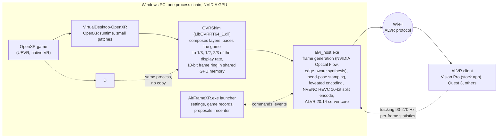

## What it looks like

The windows, at 1080p and 125 % scale, rendered by the project's own UI harness with demo data (a made-up game history and headset, no real person's data).
Regenerate them with `python3 harness/readme_screens.py`.

**One front door.** Double-click `AirFrameXR.exe`: a card per tool, the OpenXR runtime switch (it switches back, too), and reviews of the OpenXR layers and the firewall rules.

<p align="center">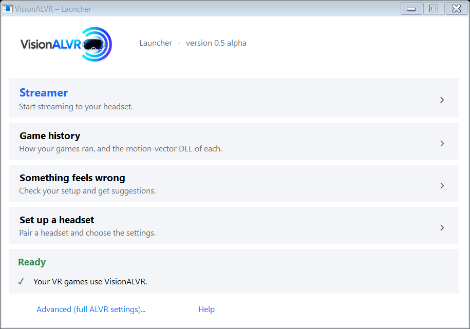</p>

**The streamer.** Live numbers as tiles (the game's fps, what is streamed, what the headset shows, bitrate, latency split, loss), display settings, frame generation with its rate, Recenter, and the optional desktop mirror.

<p align="center">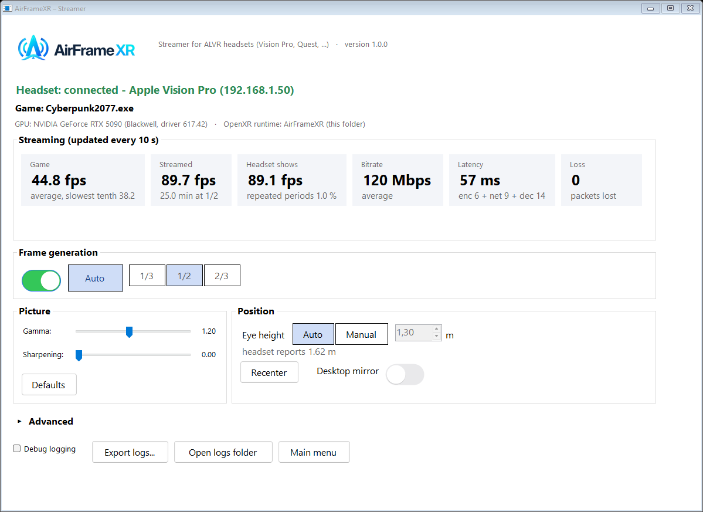</p>

**What happened in each game.** One record per game: the last sessions with fps, latency, network and GPU; export a log zip.

<p align="center">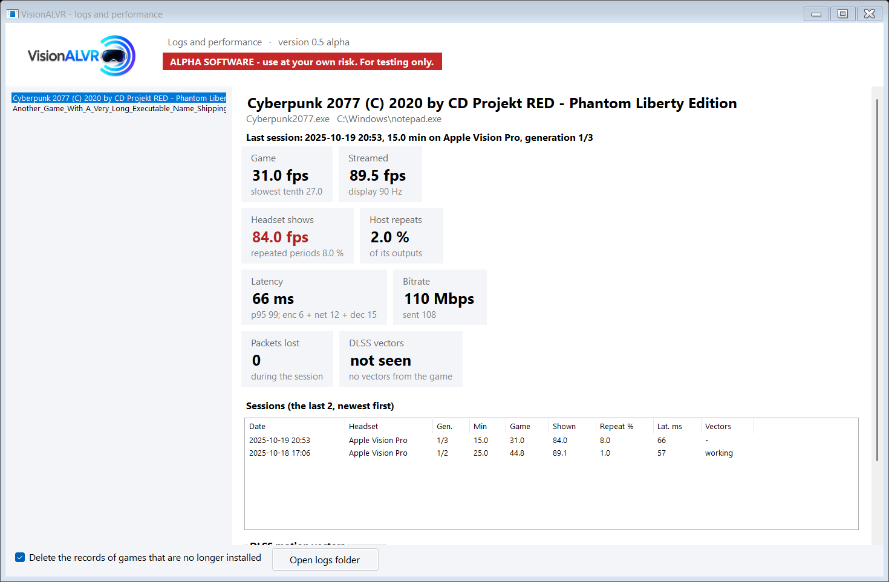</p>

**Diagnose, with suggestions.** The wizard's checks on your settings as they are, and a list of suggestions taken from [docs/PERFORMANCE_KNOBS.md](docs/PERFORMANCE_KNOBS.md): each says what it measured (this run's tests, or your logs and game records) and which knob it is about. Nothing changes unless you press a button.

<p align="center"></p>

**Setup, once.** The wizard reads what the headset supports, offers a community profile, a pre-filled manual setup or your existing ALVR settings, then tests the result.

<p align="center">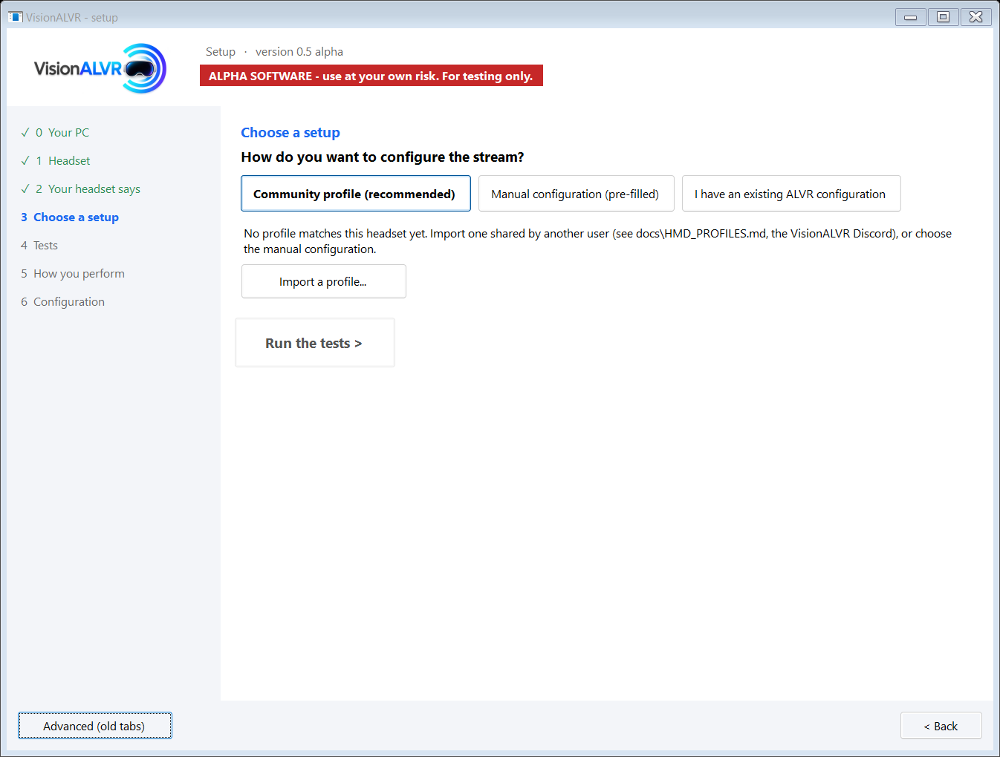</p>

**Firewall rules.** Finds the rule for this folder's exact `alvr_host.exe`, offers one only if none is in place, and lists the leftovers Windows keeps (stale, duplicate, blocking) with one click to remove them.

<p align="center">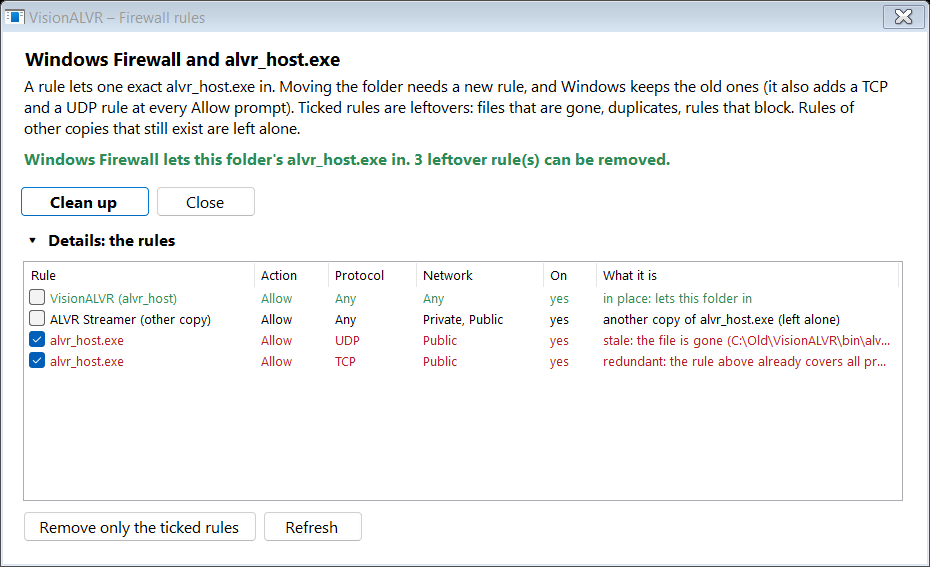</p>

<!-- AirFrameXR desktop mirror illustration -->
**Desktop mirror (optional).** Between games, the Windows desktop can float in front of you in the headset, and a controller (or your right hand) is the mouse: the orange beam points, trigger or pinch clicks, A / X double-clicks, grip or B / Y right-clicks, the thumbstick scrolls. Start the next game from where you sit, without removing the headset or looking at the monitor. The right controller holds the beam; **left-handed**, press the left trigger or grip and the beam is the left controller's (press the right one to give it back). It is a switch in the streamer, and an alternative to chroma-key passthrough as the idle view.

<p align="center">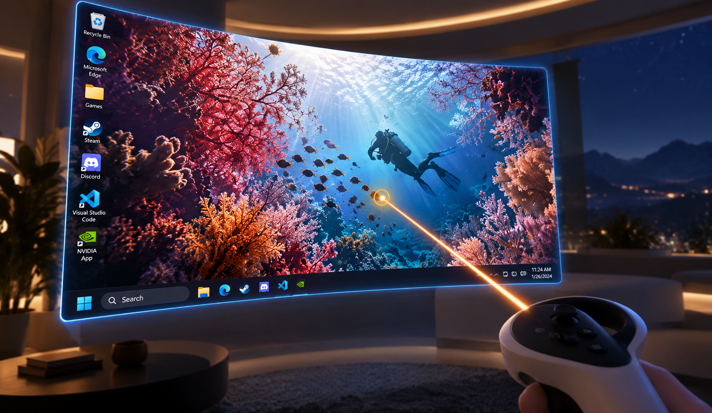</p>

*Illustration (generated artwork based on a real desktop capture, not a headset screenshot; the real screen is flat and floats over your room or the idle colour).* What the headset really gets is below: frames of the decoded stream from a test run through the whole chain, the left eye, with the right controller's beam and, after a press of the left trigger, the left controller's. Its picture is also tested on the GPU for 7 desktop shapes in SDR and HDR (see the harness below).

<p align="center">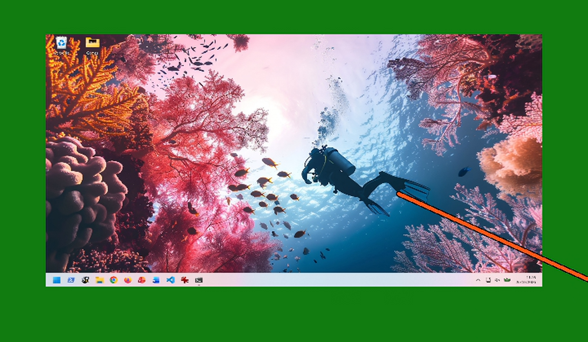 </p>

<!-- End desktop mirror illustration -->

## Features
- **Setup wizard** (`configure.exe`): reads what the headset supports, offers a community profile, a pre-filled manual configuration or your existing ALVR settings, then
  tests the result (system and NVENC, encoder speed, network at the configured bitrate, a real scene streamed through the pipeline with the headset's own head pose, audio).
  **Find headset...** in the streamer window searches the network and pairs. Any NVIDIA GPU with NVENC API 12.2+ works.
- **Frame pacing** with an intake gate and a three-deep in-order queue. The Vision Pro profile defaults to foveated encoding at 300 Mbps.
- **Frame generation** (off by default, a switch in the streamer and in Settings; experimental): for games that cannot hold the display rate. A slider sets the game's rate as a
  fraction of the display rate, **1/3, 1/2 (default) or 2/3**, and the streamer generates the frames in between. In-scene motion comes from the GPU's optical-flow engine
  (NVIDIA Optical Flow, Turing or later), the synthesis is edge-aware (motion edges stay sharp, and where the motion is uncertain the real frame is shown instead of a double
  image; ideas from [VectorXR](https://github.com/DienerTech/vectorxr), re-implemented; the earlier algorithm stays as **classic** in Advanced picture and FOV settings), and
  every output is rotated to the newest tracking sample. Verified on a Vision Pro at 100 Hz with an RTX 5090: missed display periods 38 % -> 1 % at half rate; also run on a Quest 3.
  It costs latency by construction (interpolation: one game period), and it is not automatic by design: a game that holds a steady 70-75 fps is often better left alone.
  A **Recommended** tick sets the rate from the game's recorded runs on the connected headset, and **Recenter** (a button and a key, **End** by default; also sent at every game start) turns the tracking space to your
  current forward. See [docs/FRAME_GENERATION.md](docs/FRAME_GENERATION.md), [docs/FRAME_GENERATION_UNCAPPED.md](docs/FRAME_GENERATION_UNCAPPED.md), and
  [docs/PERMANENT_RECORD.md](docs/PERMANENT_RECORD.md) (archive) for why DLSS motion vectors were tried and removed.
- **A field of view for the game, set from the streamer**, and a render quality slider: [how it works](#how-fov-restriction-works).
- **The windows** (above): one launcher, the streamer, Logs and performance, Diagnose with suggestions, the wizard, the firewall and OpenXR-layer reviews. They follow the display
  (1080p laptops to 4K, 100-200 % scale), checked by the UI harness below.
- **Desktop mirror** (optional): see above; it works with either hand.
- **Advanced picture and FOV settings**: the switches that change the picture the game renders and the timing, for people who measure. Each one says when it takes effect and what we
  measured; a switch at its default is removed from the settings file. The HEVC QP map stays on by default and its trade-off is written next to it.
- **Lab tools**: the test harness below, including a frame generation judge ([docs/FRAME_GENERATION_JUDGE.md](docs/FRAME_GENERATION_JUDGE.md)) and the QP map A/B.

What changed in each version: [docs/releases/](docs/releases/) (1.0 onward; earlier notes are in the GitHub releases and the archive). `docs/progress.md` is the current status: what is built, what is tested (and how), what is not. Older history: [docs/PERMANENT_RECORD.md](docs/PERMANENT_RECORD.md).

## Status
- **Works on the real headset** (tested on RTX 5090 + Vision Pro, and on a Quest 3 with the Meta-store ALVR client): the vast majority of
  UEVR games, Luke Ross mods (Dead Space Remake), native VR games, controllers (ALVR's Quest/Touch emulation), haptics, game audio,
  discovery/pairing with the stock app.
- **Known issues**:
  - Frame generation is still experimental.
  - Some OpenXR games need the SteamVR + ALVR fallback. OpenVR games are not supported and none is planned.
  - No USB streaming, except when bridged with ALVR's own tools.
  - HEVC encoding is baked in for maximum split-encoding performance: no H.264 or AV1.
  - On the Vision Pro, in heavy games 5-10 % of frames carry the same tracking timestamp as the previous one and the headset skips them (shown fps a little under the host
    fps). A fix exists (branch `exp/restamp-2026-10-13`) but needs a change on the visionOS client side, so it is not in the release.
  - The field of view override and render quality slider have not been tried in a real game yet (lab scenarios only).
- **Perceived quality varies a lot from one setup to another, especially with frame generation on.** Every time the same build felt different on the same PC and headset, the
  cause was a condition of the setup, not a game: the Wi-Fi channel (a neighbour's network produced micro-stutters that stock ALVR showed too; channel 149 cured them), the panel
  running 100 Hz instead of 90, the margin frames need before the headset's tick (7 ms is the default), the generation rate per game, the Quest tracking at 270 Hz being read as
  a 241 Hz display. All of these are measured and most are handled, but a new PC, router or headset will find the next one. If something feels off, the logs usually say why; see
  [docs/PERFORMANCE_KNOBS.md](docs/PERFORMANCE_KNOBS.md) for every knob, what it does and what should drive it, and
  [docs/PERFORMANCE_FINDINGS.md](docs/PERFORMANCE_FINDINGS.md) for the nights that taught us.
- The benchmark that picks settings for your PC + router + headset is half built: the headless quality sweep works (`docs/BENCHMARK_DESIGN.md`); the headset phases and applying
  the results are next. Measured on a 1-NVENC laptop GPU and a 5090.

## How FOV restriction works

**What a field of view is.** A headset image is a window onto the world, and OpenXR describes the window by four angles from the eye's view axis to its edges: left, right, up and
down (`XrFovf`). Renderers use their tangents, because a flat projection is linear in the tangent: the picture is a rectangle spanning `tan(left) + tan(right)` across and
`tan(up) + tan(down)` down, and a pixel density is "pixels per unit of tangent". The four angles are rarely equal: the nose side is smaller than the outer side. The Vision Pro's app
declares (left eye, the right is its mirror, outer = away from the nose):

| Edge | Outer | Inner | Up | Down |
|---|---|---|---|---|
| declared angle | 60.8 deg | 45.6 deg | 50.6 deg | 45.6 deg |
| declared tangent | 1.79 | 1.02 | 1.22 | 1.02 |

That is 106 x 96 degrees, with a recommended image of 3552 x 3200 per eye. The Quest 3 declares 94 x 99 degrees and shows all of it. The Vision Pro does not: measured with a grid
([docs/AVP_FOV.md](docs/AVP_FOV.md), one person, left eye, a first estimate) it shows about 80 x 74 degrees of the 106 x 96 it declares (tangents 1.69 x 1.49 instead of
2.81 x 2.24), so about half the pixels of the frame land outside what you can see.

**How games use it** (we read UEVR's OpenXR path to see). An OpenXR game asks the runtime two things when it starts. `xrEnumerateViewConfigurationViews` returns the recommended image
size per eye; `xrLocateViews` returns, with each eye's pose, the four angles. UEVR builds its projection from those angles, creates the swapchain at the recommended size (times its own
resolution slider), renders, and submits a projection layer carrying the same angles and size. It does not use a visibility mask, and nothing in the handshake announces a change
later, so a game takes these values once, when it starts. The runtime reads them once too (VDXR latches them at system creation). The consequence is the lever: **the game renders
what it is told it has**. Tell it a smaller field of view and a proportionally smaller image, and a GPU-bound game does less work.

**How AirFrameXR uses it.** The headset's real window is the contract with the client: the Vision Pro app maps the stream frame over the field of view it declared, so the frame
must keep covering all of it. Only the game is told something else. With the Vision Pro, the frame flow is:

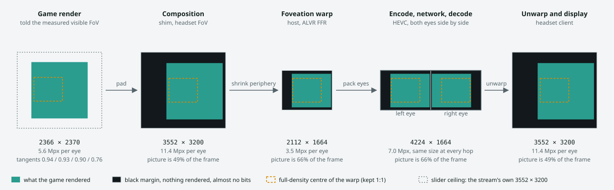

1. **The headset declares its views** when it connects (the app sends the render frustum, `views_config`). The host saves them in `config\airframexr_views.json`; the Advanced window
   shows them greyed.
2. **You choose what the game is told**: in *Advanced picture and FOV settings*, tick the override and set the four tangents (outer, inner, upper, lower). Values are never more than
   the headset's and at least a fifth of them. For the Vision Pro, [docs/AVP_FOV.md](docs/AVP_FOV.md) gives the visible window and a row of values that fit it (0.94 / 0.93 / 0.90 /
   0.76). The host turns them into per-edge fractions of the headset's tangents and publishes them to the shim.
3. **The shim answers the game** at its next start: `GetEyeFov` returns the restricted angles, and the recommended size is the stream's eye size scaled by the restricted span on
   each axis (2366 x 2370 for the row above, 49 % of the pixels). The game renders that, with the restricted projection.
4. **Composition puts it back where it belongs.** The shim maps the game's layer into a frame that covers the headset's whole field of view (3552 x 3200 per eye), the margin the game
   did not render stays black, and the picture sits where those angles fall in the frame.
5. **The foveation warp, encode, network and decode do not know.** Both eyes go through ALVR's foveation warp into one 4224 x 1664 frame and through NVENC as before. The black
   margin lies in the periphery, which the warp shrinks the most, so it is 51 % of the composed frame but 34 % of the stream frame, and black blocks cost almost no bits.
6. **The client unwarps** and maps the frame over the declared field of view, as always. The margin shows as black at the edges, outside what the lens shows anyway (for the values
   above).

So the saving is the game's GPU work only; encode time, bitrate, decode time, frame generation and the headset app are unchanged. A game that is not GPU-bound gains nothing. The values
apply at the **next game start**, and the override remembers the headset's field of view it was made for: connected to a headset whose field of view differs (a Quest after a Vision Pro), it is not applied and the window says so (on a Quest, a lower of 1.00 would cut its 55-degree
down edge); ticking again starts from the new headset's own values.

**Spending the saving: the render quality slider.** Under the fields, a slider moves the recommended size between two limits computed from your own settings: the **floor** (what
the restriction gives, the stream's pixel density over the smaller view) and the **ceiling** (the stream's own per-eye size, from your resolution settings, so a Quest's smaller one
works the same way). The window shows both and the size at the slider. For the Vision Pro with the values above:

| Slider | Game render per eye | Cost vs the floor | Samples per stream pixel |
|---|---|---|---|
| 0 % | 2366 x 2370 (5.6 Mpx) | 1.0x | 1.0 |
| 50 % | 2959 x 2785 (8.2 Mpx) | 1.5x | about 1.5 |
| 100 % | 3552 x 3200 (11.4 Mpx) | 2.0x | about 2.0 |

The game's picture is filtered down to the stream's pixels by composition, so the extra pixels are supersampling: cleaner edges and less shimmer, not detail beyond what the stream
carries. The cost is the game's GPU time and video memory, roughly linear in pixels for a GPU-bound game; 100 % costs what the game cost with no restriction. About 2 samples per pixel
is already near where supersampling stops paying much, so there is no reason to go higher. Which position is right depends on how much headroom the game has: raise it while the game
holds its frame rate. Off by default (0 %), and with no restriction nothing differs from 1.0.

**What is not known yet.** The visible window is one person's left eye at one fit of the headset; it moves with the seal, glasses inserts and IPD, so start from the recommended row
(visible + 3 degrees) and check the corners for black with `fovgrid.exe` ([docs/FOV_GRID.md](docs/FOV_GRID.md)). The Vision Pro profile carries the measured window and the suggested render quality (25 %), and the Advanced window offers them with one button, never by itself ([docs/HMD_PROFILES.md](docs/HMD_PROFILES.md)). The feature is covered by lab scenarios (the app gets exactly the tangents
and recommended size, the margin is black, the picture sits inside it) and has not been tried in a real game. The bigger lever, spending the stream's own pixels on the visible window
only, needs the client to declare that window; the host alone cannot do it. Details and keys: [docs/EXPERIMENTAL_SWITCHES.md](docs/EXPERIMENTAL_SWITCHES.md).

## Game audio
The game's sound reaches the headset without installing anything: the host captures it with **Windows' process loopback** (everything the PC plays,
taken before the output's volume, mute and format, converted to 48 kHz stereo PCM), so the Windows default output is left alone, games that play to
another role or another device are still heard, and games started as administrator (UEVR, mods) are captured too. While the streamer runs it can
mute your PC speakers (a checkbox in Settings, on by default) and puts the mute back when it closes, even after a crash.
**Settings > Game audio capture** has the older route as a fallback: *Virtual cable (VB-CABLE)*. The streamer then makes the cable the default
output for every role, mutes the speakers, holds the cable at 100 %, sets its format to plain 2-channel 48 kHz PCM and restores everything on exit; if no
cable is installed it opens a dialog with the download page of VB-Audio (a separate product that AirFrameXR neither distributes nor supports). The wizard's
*Audio output* test plays the Littlest Tokyo music (see the credits) and listens to it with the same API the host uses. Requires Windows 10 version 2004
or newer for the default mode. The same code is checked end to end by the audio harnesses (below).

**Headset microphone** (VRChat voice, chat): ALVR's own path, which needs a virtual cable (a recording device cannot be created without a driver): tick *Headset microphone for games* in Settings or on the wizard's configuration page; if VB-CABLE is missing a dialog links to its download page (VB-Audio's own product, at your own risk). While the streamer runs, the cable's recording side (CABLE Output) is the default microphone, and your previous one comes back when it closes; the game audio then uses process loopback, whatever the capture setting says. Off by default, and nothing changes when it is off. Not covered by the lab: it was never tested with a real voice.

## Requirements
- Windows 10/11, an **NVIDIA** GPU with a current driver (NVENC API 12.2+); RTX 40 series or newer recommended (several NVENC chips enable split encoding).
- Apple Vision Pro with the **ALVR** app (20.14.x), PC and headset on the same LAN (Wi-Fi 6 on 5 GHz for the first Vision Pro; 6 GHz is for newer models and Quest 3). Other headsets with an ALVR client: see above.
- **Wired connection**: a Meta Quest on USB works through **USB tethering** (the headset then appears to the PC as a network interface) or through [ADBForwarder](https://github.com/alvr-org/ADBForwarder) (ALVR's small adb helper; run it, open the ALVR app on the Quest, and use `127.0.0.1` as the headset address: the wizard shows a *Meta Quest on a USB cable?* link when nothing is found). AirFrameXR itself does not run adb. The Vision Pro Developer Strap works as a network link the same way.
- SteamVR and ALVR's own launcher closed while streaming (same ports).

## Recommended network setup
The stream is 100+ Mbit/s of low-latency video: the network matters more than the PC. What works best:
- **A Wi-Fi 6 (or newer) router dedicated to the headset**, in the same room (line of sight if you can). The first Vision Pro (M2) has
  **Wi-Fi 6 on 5 GHz only (no 6 GHz)**: use the 5 GHz band with a **160 MHz channel**. A 6E/7 router is fine, and the 6 GHz band is for
  newer Vision Pro models and the Quest 3. Put it in **dumb access point mode** (router functions, NAT and its own DHCP server off), wired
  by Ethernet to your main router or switch, so the headset stays on the same subnet as the PC and no second NAT adds latency.
- **PC on Ethernet** (not Wi-Fi), on the same network as the access point.
- **A fixed IP for the headset**: a DHCP reservation on your DHCP server (usually the main router) bound to the headset's **MAC address**.
  In visionOS, set *Private Wi-Fi Address* to Off (or Fixed) for this network, otherwise the MAC address can change and the reservation
  stops matching. A fixed address makes pairing and reconnecting reliable.
- Nothing else heavy on that access point while you play (downloads, other headsets).

## Install (users)
Download the release zip, unzip it anywhere and double-click `AirFrameXR.exe` (the launcher, the only file in the folder's root): switch the
OpenXR runtime to AirFrameXR once (one administrator prompt; the same button switches back), run the **Setup wizard** (pair the headset,
tests, settings), then **Streamer** (keep it open while you play). Details, settings and logs: [docs/INSTALL.md](docs/INSTALL.md).
The headset's address does not have to be fixed: AirFrameXR dials the saved address, finds a paired headset again by name on its own,
and the **Find headset...** button in its window searches the network, pairs a new headset or takes an address you type.
`configure.exe` offers a shared **community profile** for your headset (JSON files, import/export, see [docs/HMD_PROFILES.md](docs/HMD_PROFILES.md); the
starter Quest and Pico profiles are not verified yet), a manual configuration or your existing ALVR configuration, then tests the result on your PC and network.

## Build from source (contributors)
AirFrameXR builds **on Windows only** (MSVC, the Windows SDK and NVENC; cross-compiling from Linux is not supported). With the
prerequisites installed ([docs/DEVELOPMENT.md](docs/DEVELOPMENT.md): Git, Rust, CMake, LLVM, NuGet, Visual Studio 2022 with C++,
all available through `winget`, plus an NVIDIA driver):
```powershell
git clone https://github.com/jfbobier/AirFrameXR.git
cd AirFrameXR
powershell -ExecutionPolicy Bypass -File build.ps1
```
The first run fetches ALVR v20.14.1 and VirtualDesktop-OpenXR at pinned commits and builds them (10+ minutes, ~6 GB); the
result is the same portable folder and zip as the release, in `out\dist\`. An automated test harness (end-to-end scenarios with
a headless mock ALVR client, no headset needed) is described in [harness/README.md](harness/README.md).
See also [CONTRIBUTING.md](CONTRIBUTING.md).

## Repository layout
| Path | What |
|---|---|
| `tools/host/` | `alvr_host` (Rust): ALVR server_core embedded, encoder loop, pacing, benchmarks, logging |
| `nvenc/hostlib/` | C++ library of the host: NVENC wrapper around ALVR's encoder, IPC, QP map, benchmark renderer + quality metric |
| `nvenc/upstream/` | ALVR's encoder sources, vendored **unmodified** (checksums in `nvenc/upstream.sha256`; patched at build time by `tools/host/build.rs`) |
| `ovrshim/` | OVRShim: the LibOVR-side driver loaded by VDXR (fork of VDXR's OVRNull): layer composition, frame ring, IPC |
| `tools/gui/` | the C# WinForms tools: `Stub.cs` (root `AirFrameXR.exe`), `Launcher.cs`, `AirFrameXR.cs` (streamer), `Wizard.cs` / `Configure.cs` (`configure.exe`), `Performance.cs`, `Verdict.cs`, shared `Common.cs`; `UiTest.cs` is the UI harness's test program (not shipped) |
| `tools/install/` | portable-folder scripts (OpenXR runtime registration), shipped default session |
| `tools/mock_client/` | headless ALVR client (Rust, ALVR's client_core) used by the harness |
| `tools/probe/` | `xr_probe`: OpenXR test app (layers, input, pacing) |
| `tools/bench_scene/` | offline converter of the benchmark scene (glTF + Draco -> `.vab`) |
| `tools/patches/`, `tools/remote/` | the one ALVR patch (test-only loopback binding), PowerShell build/test stages run on the builder |
| `tools/check_firewall_rules.bat` | prompt-driven firewall check and clean-up for `alvr_host.exe` rules (not shipped in the zip) |
| `harness/` | test harness (Python, stdlib only): scenarios, checks, builder orchestration, and the GUI / desktop harnesses |
| `third_party/` | vendored headers (cgltf, stb_image) and licence texts |
| `docs/` | install guide, benchmark design, progress log |

## Relationship to upstream (how much is forked)
Nothing is a long-lived fork: ALVR and VirtualDesktop-OpenXR are fetched at pinned upstream commits (`deps.lock.json`) and
built with small, asserted patches, so an upstream change fails loudly instead of drifting.
| Upstream | How it is used | Changes |
|---|---|---|
| **ALVR v20.14.1** (Rust) | `server_core`, protocol, sockets, audio, session crates linked into `alvr_host` as a workspace member; client_core in the test client | one patch, 26 changed lines (`tools/patches/loopback-client.patch`): lets the test client bind its own loopback address; inactive unless `ALVR_BIND_IP` is set (it is compiled into `alvr_host.exe` through the shared `sockets` crate) |
| **ALVR encoder C++** (`VideoEncoderNVENC`, `NvEncoder*`, foveated encoding `FFR`, ~3,900 lines + NVIDIA's header) | vendored **unmodified** in `nvenc/upstream/` (checksums) | about 20 asserted build-time text replacements in `tools/host/build.rs`: 10-bit texture format, NVENC SDK 12.2 field names, a struct initializer the newer SDK broke, real error messages, split-frame encoding, QP delta map, reconstructed-frame output, accessors and a config dump |
| **VirtualDesktop-OpenXR** (the OpenXR runtime) | built from upstream at a pinned commit | 4 text patches + 1 define at build time (`tools/remote/stage15_vdxr.ps1`): per-eye visibility on quad/cylinder/cube layers in "Oculus runtime" mode, all 6 faces of cube swapchains, the runtime's display name, VDXR's own running start off (the game's `xrWaitFrame` waits for the shim's release), advertise the cube-layer extension |
| **VDXR's OVRNull** (sample "null" LibOVR driver) | `ovrshim/` = OVRShim, the one real fork | `driver.cpp` grew from 793 to ~1,850 lines (~1,190 new or changed), 6 new files (IPC, layer shaders); OVRNull's other ~1,570 lines are used unchanged |

Everything else is new code (~11,000 lines): the host (`tools/host`, Rust), the encoder library and benchmark
(`nvenc/hostlib`, C++), the GUIs, the installer scripts, the mock client, the OpenXR probe and the harness.

<!-- AirFrameXR developer philosophy -->
## For developers: design philosophy

**Performance first. Complexity last.** AirFrameXR is deliberately narrow: a fast, lean OpenXR-to-headset pipeline, not a universal VR launcher or a collection of optional frameworks.

- **No feature bloat.** Every feature must solve a real, demonstrated problem in the project's core streaming path. A larger settings surface, more modes, and broader platform coverage are not goals by themselves. A useful feature can still be declined if its long-term complexity outweighs its value.
- **One tool, one job.** Keep each component focused, with a clear responsibility and minimal coupling. Prefer a small tool that does one thing reliably over a multipurpose layer full of switches.
- **Native tooling where it fits.** Prefer Windows facilities, OpenXR, NVIDIA NVENC/Optical Flow, and existing build/runtime capabilities over extra dependencies, wrappers, background services, or bundled frameworks. Reuse working upstream code; avoid reinventing mature primitives.
- **Measured improvements only.** Frame pacing, latency, quality, compatibility, and code size should be justified by reproducible tests and actual headset behavior. Don't trade predictable performance for features that only look attractive on a checklist.
- **AI-assisted contributions welcome, with accountability.** If AI wrote, refactored, or materially designed any part of a contribution, include a separate Markdown work summary at `docs/ai-contributions/YYYY-MM-DD-short-topic.md` describing what the AI did, what the human reviewed, what was tested, and what remains unverified. Use [`TEMPLATE.md`](docs/ai-contributions/TEMPLATE.md). AI output is a starting point, not evidence that code works.

See [the development philosophy](docs/DEVELOPMENT_PHILOSOPHY.md) and [contribution requirements](CONTRIBUTING.md) before proposing changes. **This project will not become feature-bloated.**

## For developers: the testing harness

Everything above was tuned by one person and an AI agent working the same loop every evening: change, build on the PC, run the lab,
read the verdicts, then one headset session with the logs on. The lab is what makes that loop honest, because a headset session is one
person's eyes on one evening's Wi-Fi, and the lab is the same pipeline under conditions you choose, with a judge that does not get tired.

Nothing in the lab is a mock of the pipeline: the real host, shim, intake, clock, generator and encoder run; what is replaced is the game,
the headset and the network, each by something whose behaviour is known exactly, so that any defect in the picture is the pipeline's.

| piece | what it is | where |
|---|---|---|
| **Fake game** | `xr_probe`, a real OpenXR app with knobs: frame time as a range (`XR_PROBE_LOAD=fps:40:50`, `jitter:30`, `ramp`, `burst`), CPU and GPU cost separately (`XR_PROBE_CPU_MS`, `XR_PROBE_GPU_COPIES`), a world-fixed ring of markers for the head-rotation judge, a marker moving at a known speed for the motion judge, on the game clock or the wall clock, and exact DLSS-style motion vectors (`XR_PROBE_MV=truth`) to test the vector path without a game | `tools/probe/xr_probe.cpp` |
| **Fake headset** | the simrig (`cargo feature simrig`): a synthetic head, still or turning, that sends tracking with the timing imperfections of a *recorded* real session (tick jitter, bunching, prediction noise), and a viewer (`simviewer`) that displays what the headset would, reprojection included, at a chosen panel rate, waking up late the way a client does | `tools/host/src/simrig.rs`, `nvenc/hostlib/simviewer.cpp` |
| **Real-life conditions** | profiles made from recorded headset sessions: `real_games_pred0.json` (the timing of real game sessions), `real_probe_pred100.json` (the client's 100 ms prediction noise); the ideal profile is the null case that must be clean or the rig itself is wrong | `harness/simrig/profiles`, `make_profile.py` |
| **Judge** | from what the viewer displayed, not from host counters: the head-rotation residual against the analytic view of the ring (rms, p99, high-frequency part, stereo disparity) gives **CLEAN / TREMBLE** (0.04 deg hf, about 0.7 px on a Vision Pro); the moving marker's world angle per display tick (frozen periods, gaps the host did not fill, step regularity) gives **SMOOTH / JUDDER**. A self-test injects wrong poses and must say TREMBLE | `harness/simrig/judge.py` |
| **Scenarios** | 34 named conditions, each a sentence long: the null cases (`ideal`, `steady`, `steady_fg`), stuttering apps with and without generation (`stutter`, `stutter_fg`, `stutter_turn_fg`), each rate (`third`, `stutter_third`, `two_thirds`, `jitter_two_thirds`), the vector path (`*_mv`), uncapped generation (`*_unc`), GPU-bound apps (`gpu`, `gpu_unc`), the judge's own trap (`inject`). `run_sim.py list` prints them with what each expects | `harness/simrig/run_sim.py` |
| **Live harness** | the same loop on the real headset, unattended: build on the PC from the working tree, deploy, start the host and a game or the synthetic source, stream N seconds, fetch the debug session, score it; A/B variant files; a baseline run against stock SteamVR + ALVR on the same rig | `harness/live.py`, `live_variants.json`, `baseline.py`, `stock.py` |
| **Session logs** | with the launcher's debug tick: every host event (`host_events.jsonl`, 2-second encoder windows with the pipeline's counters), the headset's per-frame statistics (`client_frames.csv`), the shim's per-frame trace, the GPU's clocks and power state (`gpu.csv`); the analyses in `docs/PERFORMANCE_FINDINGS.md` are joins over these | `logs\debug\<session>` |
| **Benchmarks and probes** | the headless encoder quality sweep and the network bench behind the setup wizard, the wizard's own end-to-end test, the NVENC split-frame probe, the D3D11/D3D12 interop test that pinned the shared-texture flag bug, the motion-vector plumbing check | `harness/run.py`, `wizard_e2e.py`, `tools/nvenc_split_probe`, `tools/interop_test`, `harness/simrig/check_mv.py` |
| **Stability harness** | fault injection and soaks on the real chain (host, shim, fake game, mock headset): the headset's tracking silent for 5 or 30 s, the host or the headset frozen, 15 reconnects, the streamer window not reading the host's output, VRAM and RAM squeezed to what a smaller PC has, motion vectors dropped or re-created, and a seeded soak of plausible events (settings, generation toggles, blackouts, audio device changes); a judge reads stalls, vectors used and memory growth per process. Slow (about 90 minutes for the suite, hours for a soak), so it is **optional**: run it on major changes, not on every build | `harness/stability/` (`python3 harness/stability/run_stability.py list`), harness/README.md |
| **GUI matrix** | every window and wizard page at 1080p / 1440p / 4K x 100-200 % Windows scale, audited for fit, clipping, overlap and cut-off text, with a screenshot per case | `harness/ui_matrix.py`, `tools/gui/UiTest.cs` |
| **Launcher round trip** | the launcher hides while a tool is open and returns when all are closed; the root stub starts it | `harness/launcher_flow.py` |
| **Desktop mirror** | 7 desktop shapes x SDR / HDR (3 SDR-white levels) rendered on the GPU: colours, placement, cursor size; the input maths (including the left / right hand-over of the beam) as unit tests; the app through the whole chain with scripted controllers (right-handed: `e2e_mirror`; the left trigger takes the beam: `e2e_mirror_left`); real-desktop screenshots of both hands | `harness/mirror_check.py`, `tools/probe/desktop_probe.cpp`, `tools/mirrordesktop/`; `e2e_mirror`, `e2e_mirror_left`; `harness/mirror_screenshot.py --real` |
| **Field of view the game is told** | what an OpenXR app receives at startup against what the headset declared and what was asked: the probe app logs what UEVR reads (the four tangents per eye from `xrLocateViews`, the recommended image size); the checks compare them with the headset's views, then sample the decoded stream (the trimmed margin black, the picture just inside it). Unrestricted control (nothing differs from 1.0), a restriction in percent (lab flag), an override in tangents (lab flag and as the streamer sends it on the host's stdin); the streamer forwards a change once and never repeats it (render quality included, as the fifth value); the render quality slider at 0.5 and 1 (the recommended size lands halfway and at the stream's eye size, the tangents, margin and picture unchanged), and its Advanced-window row in the GUI matrix at every resolution and scale; the headset profile's measured-window button (the shipped Vision Pro profile reproduces the documented row, the click fills the fields and the slider and saves) | `e2e_fov_restrict_none`, `e2e_fov_restrict`, `e2e_fov_override`, `e2e_fov_override_live`, `e2e_fov_restrict_quality_half` / `_full`, `ui_matrix.py` (`advanced-switches-fov-quality`, `advanced-switches-fov-profile`), `fov_profile_check.py`, `streamer_events.py` (`fov_forward`), host unit tests (`vision::fov_scale_from`) |
| **Frame generation judge** | the generated frame against the frame the scene really has there: the animated benchmark scene is rendered at two times (the pair a half-rate game delivers) and at the midpoint (the ground truth); each synthesis (classic, edge, edge-blend) generates the midpoint with the streamer's own generator; PSNR / SSIM over the frame, in the moving region and on its boundary band, edge energy in excess (double images) or in deficit (blur), holding and blending as references, scene / head / both motion at several speeds and rates, paired statistics with standard errors, picture montages. First run: edge +2.0 dB over classic (sharper in 63 of 63 cases), edge against edge-blend a tie | `harness/fg_judge.py`, `tools/host/src/fg_judge.rs`, [docs/FRAME_GENERATION_JUDGE.md](docs/FRAME_GENERATION_JUDGE.md) |
| **Encoder A/B** | the quality benchmark as the judge of an encoder setting: the same sweep with the foveal QP map off and on, at several bitrates and a Quest-class eye size (centre / periphery / weighted PSNR, encode time, produced bitrate); the Encoding radio buttons of the settings window exclude each other | `harness/qpmap_ab.py`, `run.py bench-quality --qp on\|off --eye WxH --mbps N`, `harness/encoding_radios_check.py` |
| **Audio chain** | the streamer, the mock headset and the Littlest Tokyo scene (it plays music): in process-loopback mode the default output stays untouched and the headset's process plays what the host captured; in cable mode the cable is the default and carries the music; the PC speakers are muted (checked on the endpoint and, in a quiet room, with the builder's microphone against an unmuted control); the streamer exits when its window closes and everything is restored | `harness/audio_chain_check.py [--device]` |
| **Audio routing (cable path)** | defaults, mute, 100 % and the 2 ch / 48 kHz format, a default stolen while running, a named device, no cable, crash recovery | `harness/audio_route_check.py` |
| **Audio probes** | process loopback independent of mute, volume and the device's own format; an elevated player heard by a normal process | `harness/process_loopback_probe.py`, `harness/elevated_audio_check.py` (accept the UAC prompt) |
| **Firewall review** | the rule analysis against real throwaway rules, and the `.bat` | `harness/firewall_check.py` |
| **Compile checks from WSL** | host, shim and C++ checked without the Windows builder | `tools/wsl/check_host.sh`, `check_cpp.sh`, `check_gui.sh` |

How it is used: `python3 harness/simrig/run_sim.py build` once, then `run <scenario> --seconds 40`; results land in `harness/results/<UTC>_simrig_<name>/`
with the verdict JSON, the viewer's CSVs and the host's debug session. `docs/DEVELOPMENT.md` has the full recipe, the builder setup and the
profiles (`AIRFRAMEXR_PROFILE`) that point the harness at your PC.

**Debug and release builds (the telemetry flavour).** The per-frame traces the lab needs cost CPU on every frame, so they are a compile-time
flag. A **debug build** (the default of `python3 harness/run.py build ...`) keeps them: the shim's per-frame trace (`shim_frames.csv`: pose
read, head-sample arrival, release, submit, publish), the host's frame fates and sent-frame CSVs, the audio-capture trace and a scheduler
probe, written into a debug session folder when debug logging is on. The frame-by-frame analysis (`harness/frames.py`), the pacing and
judder scenarios and the simrig need them. A **release build** (`--release`: cargo `--no-default-features`, the shim compiled with
`AIRFRAMEXR_RELEASE`) compiles them out; the periodic statistics behind Game history, Diagnose and its suggestions stay in both. Build one
with `python3 harness/run.py build host shim gui package` (debug) or `... package --release` (release; what a public release uses);
`build.ps1` is the other way round (release by default, `debug` as a target). A debug package says so: its zip name ends in `-debug` and
the windows show "(debug build)" after the version. New per-frame telemetry must sit behind the flag (`docs/DEVELOPMENT.md`).

**Pull requests.** A change to anything on the frame path (shim, pipeline, generator, encoder, pacing) is accepted only with the lab's proof
in the description: the scenarios relevant to the change, their verdicts before and after, and the compile checks. "It looks fine in my
headset" is where this project started, and the harness exists because it was not enough. A PR that adds a scenario for the condition it
fixes is the normal case. A change to the GUI needs `harness/ui_matrix.py` to stay at 0 FAIL (see [harness/README.md](harness/README.md): the rules it enforces).

**Transferable.** Nothing in the harness is specific to AirFrameXR except the IPC it hooks. A fake game with controllable cost and exact
vectors, a fake headset replaying recorded tracking imperfections, a viewer that reprojects like a client, and a judge that measures the
picture rather than the counters, apply to any project that optimises the OpenXR-to-headset chain: another streamer, a compositor, a
frame-generation layer. Take it.

## Credits
AirFrameXR stands on the shoulders of giants: the projects below made it possible and gave it solid foundations to build on.
- **[ALVR](https://github.com/alvr-org/ALVR)** (MIT) by polygraphene and the alvr-org contributors: the foundational
  infrastructure this is built on, its streaming protocol, server core, networking, audio, foveated encoding and NVENC
  encoder code, and the [ALVR visionOS client](https://github.com/alvr-org/alvr-visionos) that runs on the headset.
  AirFrameXR exists because ALVR made wireless PC VR open.
- **[VirtualDesktop-OpenXR (VDXR)](https://github.com/mbucchia/VirtualDesktop-OpenXR)** (MIT) by Matthieu Bucchianeri and its
  contributors: the excellent, highly optimized OpenXR runtime every game here runs on; OVRShim started as its OVRNull sample.
  Thanks also for the many other OpenXR tools from the same author that the PC VR community relies on.
- **[OFXR-Bridge](https://github.com/tig3rmast3r/OFXR-Bridge)** (LGPL-3.0) by tig3rmast3r: the frame-generation synthesis recipe
  (rotation-compensated residual flow, midpoint sampling, confidence and crossfade fallback) and its never-block safety rules were
  studied from its code and re-implemented here; it is the "classic" synthesis.
- **[VectorXR](https://github.com/DienerTech/vectorxr)** (MPL-2.0) by DienerTech: the edge-aware synthesis (vector median, source-solved
  flow, per-pixel candidate choice at motion boundaries, doubtful motion shrinking toward the real frame) was studied from its code and
  re-implemented here.
- NVIDIA Video Codec SDK and Optical Flow SDK headers (MIT). cgltf (MIT), stb_image (public domain / MIT), Draco (Apache-2.0, offline converter only).
- Benchmark scene: "Littlest Tokyo" by Glen Fox ([glenatron](https://sketchfab.com/glenatron)), CC-BY-4.0, converted and placed
  in a textured room. Its music: "Sakura Breeze" by [Roa Music](https://soundcloud.com/roa_music1031), royalty-free music from
  [free-stock-music.com](https://www.free-stock-music.com), CC BY 3.0 ([licence](https://creativecommons.org/licenses/by/3.0/deed.en_US)), shortened and re-encoded.

Details: [THIRD_PARTY_NOTICES.md](THIRD_PARTY_NOTICES.md). AirFrameXR is not affiliated with or endorsed by the ALVR project,
Apple, NVIDIA, Virtual Desktop, OFXR-Bridge or VectorXR. Apple Vision Pro and visionOS are trademarks of Apple Inc.

## License
MIT, see [LICENSE](LICENSE). Third-party components keep their own licences ([THIRD_PARTY_NOTICES.md](THIRD_PARTY_NOTICES.md)).

## Documentation

- [docs/ARCHITECTURE.md](docs/ARCHITECTURE.md): the frame pipeline, its threads and buffers
- [docs/FRAME_GENERATION_JUDGE.md](docs/FRAME_GENERATION_JUDGE.md): the lab judge for generated frames (against a rendered ground truth)
- [docs/FRAME_GENERATION.md](docs/FRAME_GENERATION.md): frame generation: half-rate pacing + interpolated frames; [docs/FRAME_GENERATION_UNCAPPED.md](docs/FRAME_GENERATION_UNCAPPED.md): the uncapped mode, cap and lag, headset-night verdicts; the DLSS motion-vector experiment (removed in 0.6.1) is in the archive, [docs/PERMANENT_RECORD.md](docs/PERMANENT_RECORD.md)
- [docs/AVP_FOV.md](docs/AVP_FOV.md): the Vision Pro's declared and visible field of view, and the override values that fit it; [docs/FOV_GRID.md](docs/FOV_GRID.md): the grid app that measures it; [How FOV restriction works](#how-fov-restriction-works)
