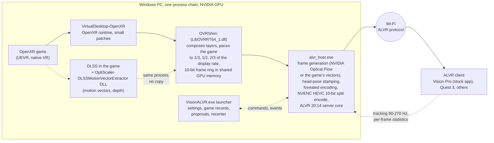
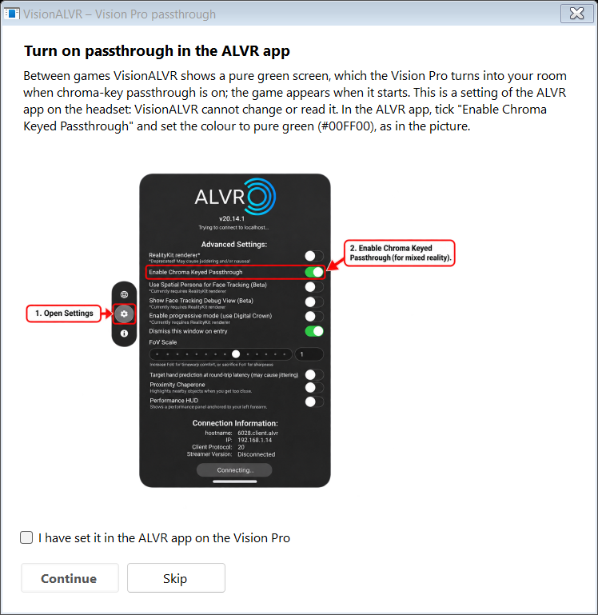

<p align="center">
  <picture>
    <source media="(prefers-color-scheme: dark)" srcset="docs/images/logo-dark.png">
    
  </picture>
</p>

# VisionALVR

**Stream PC VR games to any ALVR headset, without SteamVR, through one lean NVIDIA-accelerated chain, with frame generation built in.**
Made for the Apple Vision Pro and 90 Hz; tested on the Quest 3 too.

VisionALVR replaces the SteamVR + ALVR server pair on the PC with a single streamer of about 20 MB: an OpenXR runtime, a compositor shim and
the ALVR protocol in one process chain, written for NVIDIA GPUs end to end. Because it owns the whole path from the game's swapchain to the
Wi-Fi packet, every stage is tuned against the next one instead of stacked mods negotiating through SteamVR:

- **No SteamVR.** The game talks OpenXR to a small runtime; no SteamVR compositor, no extra frame copies between processes, no dashboard.
- **NVIDIA all the way.** NVENC HEVC 10-bit with split-frame encoding across the GPU's encoders, ALVR's foveated encoding when you want it,
  NVIDIA Optical Flow for the generated frames, and the game's own **DLSS motion vectors** when the
  [OptiScaler-DLSSMotionVectorExtractor](https://github.com/jfbobier/OptiScaler-DLSSMotionVectorExtractor) DLL sits in the game folder
  (shipped in the zip as `DLSSMotionVectors\dxgi.dll`). Shared GPU memory between the
  game, the shim and the encoder; nothing crosses the CPU.
- **Frame generation that is part of the pipeline, not a mod on top of a mod.** The game is paced to 1/3, 1/2 or 2/3 of the display rate and
  the streamer interpolates the rest, every output rotated to the newest head pose. On an RTX 5090 and a Vision Pro: a 40 fps Unreal game
  streams at the panel's 90-100 Hz with 0.5-2 % of the headset's periods repeated and 67 ms of total latency, against 40-50 % repeated and
  86 ms without it. A per-game record proposes the rate that held last time, on this headset.
- **Every ALVR client.** The headset sees an ordinary ALVR 20.14 server: the stock ALVR app on the Vision Pro, the Meta-store client on the
  Quest, the others untested but expected to work. Focus and tuning: the Vision Pro at 90 Hz.
- **Lean by design.** One zip, no installer, no registry beyond the OpenXR runtime registration (undone by a script), a settings file you can
  read, a launcher that proposes from measurements and never decides for you.

> [!WARNING]
> **ALPHA SOFTWARE (0.4): TEST AT YOUR OWN RISK.**
> On real headsets it has been tested by one person, on one PC (RTX 5090) with one Vision Pro and one Quest 3, frame generation included
> (plus automated tests on a laptop GPU). Games may crash, fail to start, or show a broken image; the stream may stutter or have high latency. It changes your PC's OpenXR runtime registration and adds a firewall rule
> (both undone by the launcher's OpenXR runtime button, "Switch back"). Keep comfort in mind: a frozen or juddering image in a headset can cause
> discomfort; take the headset off if anything looks wrong. Provided "as is", without warranty of any kind (see [LICENSE](LICENSE)).

**Main focus:** the **Windows** streamer on an **NVIDIA** GPU (RTX 40 series or newer recommended; any NVENC 12.2 driver runs), with the **ALVR app (20.14.x) on
Apple Vision Pro**. That is what is built, tuned and tested here.

This is a **personal project**. It targets NVIDIA because that is what I run, and the Vision Pro because that is my headset.
It is not affiliated with or supported by NVIDIA, Apple or the ALVR project.
- **Other headsets**: the ALVR protocol is device agnostic, so **other headsets with an ALVR client (Quest, Pico, ...) are expected to
  work**. The Quest 3 has been tested here with the Meta-store ALVR client, frame generation included; others are not, and the encoder
  settings, defaults and the idle chroma-key frame are tuned for the Vision Pro. Reports and small fixes for them are welcome, with no
  promise of an answer or a fix; nothing that makes the Vision Pro path worse will be merged.
- **A plain green screen when the headset connects is normal and intended**: it is the streamer's idle frame while no game runs. On the
  Vision Pro turn on the ALVR app's **Enable Chroma Keyed Passthrough** and the idle colour (#107C10, the App Store app's own key colour) becomes transparent: you see your room between
  games and the game appears when it starts. If the headset stays green, the chroma key is not set. VisionALVR does not mirror the Windows
  desktop into the headset between sessions (Virtual Desktop's way) by design: see-through is the cleaner idle state.
- **AMD / Intel GPUs**: not supported and not planned. The encode path is NVENC only; you are welcome to fork and adapt it.
  [ALVR](https://github.com/alvr-org/ALVR) itself supports them.

This project **does not aim to compete with existing commercial applications**. It offers **more options to the VR community**, using the
already open source [ALVR](https://github.com/alvr-org/ALVR) as the infrastructure.

> [!NOTE]
> **Game compatibility is not the goal.** VisionALVR is a lean, low-latency path for the games that work with it; it does not aim
> to run every VR game. **For a game that does not work, use SteamVR + ALVR**: SteamVR is excellent at compatibility and at
> configurability, and this project does not try to compete with that. In testing, the vast majority of **UEVR games**, the
> **Luke Ross mods** and **native OpenXR / VR games** worked, but some games still have controller problems, crashes or both.
> Not supported: SteamVR/OpenVR-only games (they need SteamVR).

VisionALVR replaces the SteamVR + ALVR server pair on the PC with one lean streamer. It speaks the ALVR 20.14.1 protocol
unchanged, so the ALVR app on the headset sees an ordinary ALVR server. In between, it does less work:
no SteamVR compositor, no extra frame copies between processes, and an encode path written for NVENC only.



In words:

```
OpenXR game
  -> VirtualDesktop-OpenXR (VDXR, OpenXR runtime, small patches)
  -> OVRShim (LibOVRRT64_1.dll: composes layers, paces the game, shared 10-bit side-by-side frame ring)
  -> alvr_host.exe (frame generation, ALVR v20.14.1 server_core, ALVR's foveated encoding, NVENC HEVC 10-bit split encode)
  -> ALVR protocol over Wi-Fi
  -> ALVR client on the headset (stock Vision Pro app, Quest client, ...)
```

## What it looks like

The windows of 0.5, at 1080p and 125 % scale, rendered by the project's own UI harness with demo data (a made-up game history and headset, no real person's data).
Regenerate them with `python3 harness/readme_screens.py`.

**One front door.** Double-click `VisionALVR.exe`: a card per tool, the OpenXR runtime switch (it switches back, too), and reviews of the OpenXR layers and the firewall rules.

<p align="center"></p>

**The streamer.** Live numbers as tiles (the game's fps, what is streamed, what the headset shows, bitrate, latency split, loss), display settings, frame generation with its rate and DLSS motion vectors, Recenter, and the optional desktop mirror.

<p align="center"></p>

**What happened in each game.** One record per game: the last sessions with fps, latency, network, GPU and whether the game's motion vectors reached the streamer; install or remove the motion-vector DLL per game; export a log zip.

<p align="center"></p>

**Diagnose, with suggestions.** The wizard's checks on your settings as they are, and a list of suggestions taken from [docs/PERFORMANCE_KNOBS.md](docs/PERFORMANCE_KNOBS.md): each says what it measured (this run's tests, or your logs and game records) and which knob it is about. Nothing changes unless you press a button.

<p align="center"></p>

**Setup, once.** The wizard reads what the headset supports, offers a community profile, a pre-filled manual setup or your existing ALVR settings, then tests the result.

<p align="center"></p>

<table>
<tr>
<td width="50%" valign="top"><b>Firewall rules.</b> Finds the rule for this folder's exact <code>alvr_host.exe</code>, offers one only if none is in place, and lists the leftovers Windows keeps (stale, duplicate, blocking) with one click to remove them.<br><br></td>
<td width="50%" valign="top"><b>Vision Pro passthrough.</b> The one setting that lives in the ALVR app on the headset (the streamer cannot set or read it): the wizard shows where it is, once.<br><br></td>
</tr>
</table>

The desktop mirror (the Windows desktop floating in front of you between games, your right hand as the mouse) is only visible in a headset; its picture is tested on the GPU for 7 desktop shapes in SDR and HDR (see the harness below).

## Status
- **Works on the real headset** (tested on RTX 5090 + Vision Pro, and on a Quest 3 with the Meta-store ALVR client): the vast majority of
  UEVR games, Luke Ross mods (Dead Space Remake), native VR games, controllers (ALVR's Quest/Touch emulation), haptics, game audio,
  discovery/pairing with the stock app.
- **Known issues**: some games still have controller and/or crash issues (for example one Unity game crashes, one UEVR game shows
  no image, one Unity game shows its menu very small). Use SteamVR + ALVR for those. Zelda: Breath of the Wild through Cemu + BetterVR,
  once a problem case (elevated process, inventory flicker, controllers), now works fully (2026-10-18).
- **Perceived quality varies a lot from one setup to another, especially with frame generation on.** The same build felt "restored" one
  evening and "lower" the next on the same PC and headset, and every time the cause was a condition of the setup, not a game: the Wi-Fi
  channel (a neighbour's network produced micro-stutters that stock ALVR showed too; channel 149 cured them), the panel running 100 Hz
  instead of 90 under 50 Hz lighting (every generation cap 11 % tighter), the margin frames need before the headset's tick (3 ms was too
  thin for an 8-9 ms arrival spread, 7 ms is the default now), the generation rate per game (a game under its cap re-sends frozen frames
  that the headset counts as shown), the Quest tracking at 270 Hz being read as a 241 Hz display. All of these are measured now and most
  are handled, but a new PC, router or headset will find the next one. If something feels off, the logs usually say why; see
  [docs/PERFORMANCE_KNOBS.md](docs/PERFORMANCE_KNOBS.md) for every knob, what it does and what should drive it, and
  [docs/PERFORMANCE_FINDINGS.md](docs/PERFORMANCE_FINDINGS.md) for the nights that taught us.
- **New in 0.3**: a **setup wizard** (`configure.exe`) that reads what the headset supports, offers a community profile, a pre-filled
  manual configuration or your existing ALVR settings, then tests the result (system and NVENC, encoder speed, network at the configured
  bitrate, a real scene streamed through the pipeline with the headset's own head pose, audio); **Find headset...** in the streamer window;
  any NVIDIA GPU with NVENC API 12.2+ (the RTX 40 check is gone); frame pacing with an intake gate and a three-deep in-order queue;
  the Vision Pro profile defaults to foveated encoding at 300 Mbps. The "low"/"auto" latency modes were removed (they dropped 15-30 % of
  frames in GPU-bound games).
- **Vision Pro known issue**: in heavy games 5-10 % of frames carry the same tracking timestamp as the previous one and the headset skips
  them (shown fps a little under the host fps). A fix exists (branch `exp/restamp-2026-10-13`) but needs a change on the visionOS
  client side, so it is not in the release.
- **New in 0.4: frame generation** (toggle in the streamer window and in Settings, `video.frame_gen`, off by default): for games that cannot
  hold the display rate. A slider sets the game's rate as a fraction of the display rate, **1/3, 1/2 (default) or 2/3**, and the streamer
  generates the frames in between: at 1/2 and 1/3 the game is locked to the display cadence (one or two generated frames per rendered one),
  at 2/3 it is held to two thirds of the rate and every frame sent is interpolated. In-scene motion comes from the game's own **DLSS motion
  vectors** when the [OptiScaler-DLSSMotionVectorExtractor](https://github.com/jfbobier/OptiScaler-DLSSMotionVectorExtractor) DLL sits next to the game's executable
  (copy `DLSSMotionVectors\dxgi.dll` from the zip next to the game's real executable, tick *DLSS motion vectors*), else from the GPU's optical-flow
  engine (NVIDIA Optical Flow, Turing or later). Every output is rotated to the newest tracking sample. Verified on a Vision Pro at 100 Hz
  with an RTX 5090: missed display periods 38 % -> 1 % at half rate; also run on a Quest 3. Costs latency by construction (interpolation:
  one game period); small fast objects may ghost without vectors. The rate is fixed for a run; a **Recommended** tick sets it from the
  game's recorded runs on the connected headset (`config/games/<exe>.json`, written by the streamer at every game end: fps, the headset's repeated
  periods, the streamer's repeats), and the streamer window shows the last run's record when a game ends. A **Recenter** button (also sent
  at every game start) turns the tracking space to your current forward. See [docs/FRAME_GENERATION.md](docs/FRAME_GENERATION.md),
  [docs/FRAME_GENERATION_UNCAPPED.md](docs/FRAME_GENERATION_UNCAPPED.md) and [docs/MOTION_VECTORS.md](docs/MOTION_VECTORS.md). Not automatic
  by design: a game that holds a steady 70-75 fps is often better left alone.
- **New in 0.5: the windows.** Double-click **`VisionALVR.exe`** (the only file in the folder's root; a stub that opens the launcher) and pick a tool;
  the launcher steps aside while a tool is open and comes back when you close it. Everything else sits in `bin\`.
  - **Launcher** (`bin\launcher.exe`): a card per tool, plus three switches that people kept asking for: the **OpenXR runtime** (shows the active one,
    switches to VisionALVR, and the same button switches back to the previous runtime), the **OpenXR layers** review (some layers capture the
    controllers before any runtime sees them; listed, switched off and on again reversibly) and the **firewall rules** review (finds the rule for
    this folder's exact `alvr_host.exe`, offers one only if none is in place, and lists leftovers from moved or deleted copies to clean up).
  - **Streamer** (`bin\streamer.exe`): live numbers as tiles (game, streamed and shown fps, bitrate, latency split, loss), display settings,
    frame generation, **Recenter** (and a recenter key, **End** by default, set in the wizard), and an optional **Mirror Windows desktop between
    sessions** toggle: the desktop floats in front of you (SDR or HDR, converted to SDR), your right hand is the mouse (pinch = click, grip = right click);
    for games you start from the headset, off by default. After a game, if the DLSS motion vectors were missing it offers to install the DLL.
  - **Logs and performance** (`bin\performance.exe`): the games you played, one file per game (`config/games/<exe>.json`) with the last sessions (fps,
    latency, network, GPU, whether the motion vectors worked); install or remove the motion-vector DLL for a game (checked against the packaged copy,
    the master copy is never touched); export a log zip; records of uninstalled games are cleaned.
  - **Diagnose** (`bin\configure.exe --diagnose`): the wizard's checks and verdict on your settings as they are, now also covering the OpenXR layers
    and the firewall. The **Setup wizard** asks Vision Pro users once to turn on passthrough in the ALVR app (the streamer cannot set it).
  - The windows follow the display: 1080p laptops to 4K, 100-200 % scale (WinForms' own per-monitor DPI mode), checked by the UI harness below.
- The benchmark that picks settings for your PC + router + headset is half built: the headless quality sweep works
  (`docs/BENCHMARK_DESIGN.md`); the headset phases and applying the results are next.
- Measured on a 1-NVENC laptop GPU and a 5090. Multi-engine split encode is wired in but not yet active in `auto` mode.

`docs/progress.md` is the detailed log: what is built, what is tested (and how), what is not.

## Game audio
The game's sound reaches the headset without installing anything: the host captures it with **Windows' process loopback** (everything the PC plays,
taken before the output's volume, mute and format, converted to 48 kHz stereo PCM), so the Windows default output is left alone, games that play to
another role or another device are still heard, and games started as administrator (UEVR, mods) are captured too. While the streamer runs it can
mute your PC speakers (a checkbox in the Advanced settings, on by default) and puts the mute back when it closes, even after a crash.
**Advanced settings > Game audio capture** has the older route as a fallback: *Virtual cable (VB-CABLE)*. The streamer then makes the cable the default
output for every role, mutes the speakers, holds the cable at 100 %, sets its format to plain 2-channel 48 kHz PCM and restores everything on exit; if no
cable is installed it opens a dialog with the download page of VB-Audio (a separate product that VisionALVR neither distributes nor supports). The wizard's
*Audio output* test plays the Littlest Tokyo music (see the credits) and listens to it with the same API the host uses. Requires Windows 10 version 2004
or newer for the default mode. The same code is checked end to end by the audio harnesses (below).

**Headset microphone** (VRChat voice, chat): ALVR's own path, which needs a virtual cable (a recording device cannot be created without a driver): tick *Headset microphone for games* in the Advanced settings or on the wizard's configuration page; if VB-CABLE is missing a dialog links to its download page (VB-Audio's own product, at your own risk). While the streamer runs, the cable's recording side (CABLE Output) is the default microphone, and your previous one comes back when it closes; the game audio then uses process loopback, whatever the capture setting says. Off by default, and nothing changes when it is off. Not covered by the lab: it was never tested with a real voice.

## Requirements
- Windows 10/11, an **NVIDIA** GPU with a current driver (NVENC API 12.2+); RTX 40 series or newer recommended (several NVENC chips enable split encoding).
- Apple Vision Pro with the **ALVR** app (20.14.x), PC and headset on the same LAN (Wi-Fi 6 on 5 GHz for the first Vision Pro; 6 GHz is for newer models and Quest 3). Other headsets with an ALVR client: see above.
- SteamVR and ALVR's own launcher closed while streaming (same ports).

## Recommended network setup
The stream is 100+ Mbit/s of low-latency video: the network matters more than the PC. What works best:
- **A Wi-Fi 6 (or newer) router dedicated to the headset**, in the same room (line of sight if you can). The first Vision Pro (M2) has
  **Wi-Fi 6 on 5 GHz only (no 6 GHz)**: use the 5 GHz band with a **160 MHz channel**. A 6E/7 router is fine, and the 6 GHz band is for
  newer Vision Pro models and the Quest 3. Put it in **dumb access point mode** (router functions, NAT and its own DHCP server off), wired
  by Ethernet to your main router or switch, so the headset stays on the same subnet as the PC and no second NAT adds latency.
- **PC on Ethernet** (not Wi-Fi), on the same network as the access point.
- **A fixed IP for the headset**: a DHCP reservation on your DHCP server (usually the main router) bound to the headset's **MAC address**.
  In visionOS, set *Private Wi-Fi Address* to Off (or Fixed) for this network, otherwise the MAC address can change and the reservation
  stops matching. A fixed address makes pairing and reconnecting reliable.
- Nothing else heavy on that access point while you play (downloads, other headsets).

## Install (users)
Download the release zip, unzip it anywhere and double-click `VisionALVR.exe` (the launcher, the only file in the folder's root): switch the
OpenXR runtime to VisionALVR once (one administrator prompt; the same button switches back), run the **Setup wizard** (pair the headset,
tests, settings), then **Streamer** (keep it open while you play). Details, settings and logs: [docs/INSTALL.md](docs/INSTALL.md).
The headset's address does not have to be fixed: VisionALVR dials the saved address, finds a paired headset again by name on its own,
and the **Find headset...** button in its window searches the network, pairs a new headset or takes an address you type.
`configure.exe` offers a shared **community profile** for your headset (JSON files, import/export, see [docs/HMD_PROFILES.md](docs/HMD_PROFILES.md); the
starter Quest and Pico profiles are not verified yet), a manual configuration or your existing ALVR configuration, then tests the result on your PC and network.

## Build from source (contributors)
VisionALVR builds **on Windows only** (MSVC, the Windows SDK and NVENC; cross-compiling from Linux is not supported). With the
prerequisites installed ([docs/DEVELOPMENT.md](docs/DEVELOPMENT.md): Git, Rust, CMake, LLVM, NuGet, Visual Studio 2022 with C++,
all available through `winget`, plus an NVIDIA driver):
```powershell
git clone https://github.com/jfbobier/vision-alvr.git
cd vision-alvr
powershell -ExecutionPolicy Bypass -File build.ps1
```
The first run fetches ALVR v20.14.1 and VirtualDesktop-OpenXR at pinned commits and builds them (10+ minutes, ~6 GB); the
result is the same portable folder and zip as the release, in `out\dist\`. An automated test harness (end-to-end scenarios with
a headless mock ALVR client, no headset needed) is described in [harness/README.md](harness/README.md).
See also [CONTRIBUTING.md](CONTRIBUTING.md).

## Repository layout
| Path | What |
|---|---|
| `tools/host/` | `alvr_host` (Rust): ALVR server_core embedded, encoder loop, pacing, benchmarks, logging |
| `nvenc/hostlib/` | C++ library of the host: NVENC wrapper around ALVR's encoder, IPC, QP map, benchmark renderer + quality metric |
| `nvenc/upstream/` | ALVR's encoder sources, vendored **unmodified** (checksums in `nvenc/upstream.sha256`; patched at build time by `tools/host/build.rs`) |
| `ovrshim/` | OVRShim: the LibOVR-side driver loaded by VDXR (fork of VDXR's OVRNull): layer composition, frame ring, IPC |
| `tools/gui/` | the C# WinForms tools: `Stub.cs` (root `VisionALVR.exe`), `Launcher.cs`, `VisionALVR.cs` (streamer), `Wizard.cs` / `Configure.cs` (`configure.exe`), `Performance.cs`, `Verdict.cs`, shared `Common.cs`; `UiTest.cs` is the UI harness's test program (not shipped) |
| `tools/install/` | portable-folder scripts (OpenXR runtime registration), shipped default session |
| `tools/mock_client/` | headless ALVR client (Rust, ALVR's client_core) used by the harness |
| `tools/probe/` | `xr_probe`: OpenXR test app (layers, input, pacing) |
| `tools/bench_scene/` | offline converter of the benchmark scene (glTF + Draco -> `.vab`) |
| `tools/patches/`, `tools/remote/` | the one ALVR patch (test-only loopback binding), PowerShell build/test stages run on the builder |
| `tools/check_firewall_rules.bat` | prompt-driven firewall check and clean-up for `alvr_host.exe` rules (not shipped in the zip) |
| `harness/` | test harness (Python, stdlib only): scenarios, checks, builder orchestration, and the GUI / desktop harnesses |
| `third_party/` | vendored headers (cgltf, stb_image) and licence texts |
| `docs/` | install guide, benchmark design, progress log |

## Relationship to upstream (how much is forked)
Nothing is a long-lived fork: ALVR and VirtualDesktop-OpenXR are fetched at pinned upstream commits (`deps.lock.json`) and
built with small, asserted patches, so an upstream change fails loudly instead of drifting.
| Upstream | How it is used | Changes |
|---|---|---|
| **ALVR v20.14.1** (Rust) | `server_core`, protocol, sockets, audio, session crates linked into `alvr_host` as a workspace member; client_core in the test client | one patch, 26 changed lines (`tools/patches/loopback-client.patch`): lets the test client bind its own loopback address; inactive unless `ALVR_BIND_IP` is set (it is compiled into `alvr_host.exe` through the shared `sockets` crate) |
| **ALVR encoder C++** (`VideoEncoderNVENC`, `NvEncoder*`, foveated encoding `FFR`, ~3,900 lines + NVIDIA's header) | vendored **unmodified** in `nvenc/upstream/` (checksums) | about 20 asserted build-time text replacements in `tools/host/build.rs`: 10-bit texture format, NVENC SDK 12.2 field names, a struct initializer the newer SDK broke, real error messages, split-frame encoding, QP delta map, reconstructed-frame output, accessors and a config dump |
| **VirtualDesktop-OpenXR** (the OpenXR runtime) | built from upstream at a pinned commit | 4 text patches + 1 define at build time (`tools/remote/stage15_vdxr.ps1`): per-eye visibility on quad/cylinder/cube layers in "Oculus runtime" mode, all 6 faces of cube swapchains, the runtime's display name, VDXR's own running start off (the game's `xrWaitFrame` waits for the shim's release), advertise the cube-layer extension |
| **VDXR's OVRNull** (sample "null" LibOVR driver) | `ovrshim/` = OVRShim, the one real fork | `driver.cpp` grew from 793 to ~1,850 lines (~1,190 new or changed), 6 new files (IPC, layer shaders); OVRNull's other ~1,570 lines are used unchanged |

Everything else is new code (~11,000 lines): the host (`tools/host`, Rust), the encoder library and benchmark
(`nvenc/hostlib`, C++), the GUIs, the installer scripts, the mock client, the OpenXR probe and the harness.

## For developers: the testing harness

Everything above was tuned by one person and an AI agent working the same loop every evening: change, build on the PC, run the lab,
read the verdicts, then one headset session with the logs on. The lab is what makes that loop honest, because a headset session is one
person's eyes on one evening's Wi-Fi, and the lab is the same pipeline under conditions you choose, with a judge that does not get tired.

Nothing in the lab is a mock of the pipeline: the real host, shim, intake, clock, generator and encoder run; what is replaced is the game,
the headset and the network, each by something whose behaviour is known exactly, so that any defect in the picture is the pipeline's.

| piece | what it is | where |
|---|---|---|
| **Fake game** | `xr_probe`, a real OpenXR app with knobs: frame time as a range (`XR_PROBE_LOAD=fps:40:50`, `jitter:30`, `ramp`, `burst`), CPU and GPU cost separately (`XR_PROBE_CPU_MS`, `XR_PROBE_GPU_COPIES`), a world-fixed ring of markers for the head-rotation judge, a marker moving at a known speed for the motion judge, on the game clock or the wall clock, and exact DLSS-style motion vectors (`XR_PROBE_MV=truth`) to test the vector path without a game | `tools/probe/xr_probe.cpp` |
| **Fake headset** | the simrig (`cargo feature simrig`): a synthetic head, still or turning, that sends tracking with the timing imperfections of a *recorded* real session (tick jitter, bunching, prediction noise), and a viewer (`simviewer`) that displays what the headset would, reprojection included, at a chosen panel rate, waking up late the way a client does | `tools/host/src/simrig.rs`, `nvenc/hostlib/simviewer.cpp` |
| **Real-life conditions** | profiles made from recorded headset sessions: `real_games_pred0.json` (the timing of real game sessions), `real_probe_pred100.json` (the client's 100 ms prediction noise); the ideal profile is the null case that must be clean or the rig itself is wrong | `harness/simrig/profiles`, `make_profile.py` |
| **Judge** | from what the viewer displayed, not from host counters: the head-rotation residual against the analytic view of the ring (rms, p99, high-frequency part, stereo disparity) gives **CLEAN / TREMBLE** (0.04 deg hf, about 0.7 px on a Vision Pro); the moving marker's world angle per display tick (frozen periods, gaps the host did not fill, step regularity) gives **SMOOTH / JUDDER**. A self-test injects wrong poses and must say TREMBLE | `harness/simrig/judge.py` |
| **Scenarios** | 34 named conditions, each a sentence long: the null cases (`ideal`, `steady`, `steady_fg`), stuttering apps with and without generation (`stutter`, `stutter_fg`, `stutter_turn_fg`), each rate (`third`, `stutter_third`, `two_thirds`, `jitter_two_thirds`), the vector path (`*_mv`), uncapped generation (`*_unc`), GPU-bound apps (`gpu`, `gpu_unc`), the judge's own trap (`inject`). `run_sim.py list` prints them with what each expects | `harness/simrig/run_sim.py` |
| **Live harness** | the same loop on the real headset, unattended: build on the PC from the working tree, deploy, start the host and a game or the synthetic source, stream N seconds, fetch the debug session, score it; A/B variant files; a baseline run against stock SteamVR + ALVR on the same rig | `harness/live.py`, `live_variants.json`, `baseline.py`, `stock.py` |
| **Session logs** | with the launcher's debug tick: every host event (`host_events.jsonl`, 2-second encoder windows with the pipeline's counters), the headset's per-frame statistics (`client_frames.csv`), the shim's per-frame trace, the GPU's clocks and power state (`gpu.csv`); the analyses in `docs/PERFORMANCE_FINDINGS.md` are joins over these | `logs\debug\<session>` |
| **Benchmarks and probes** | the headless encoder quality sweep and the network bench behind the setup wizard, the wizard's own end-to-end test, the NVENC split-frame probe, the D3D11/D3D12 interop test that pinned the shared-texture flag bug, the motion-vector plumbing check | `harness/run.py`, `wizard_e2e.py`, `tools/nvenc_split_probe`, `tools/interop_test`, `harness/simrig/check_mv.py` |
| **Stability harness** | fault injection and soaks on the real chain (host, shim, fake game, mock headset): the headset's tracking silent for 5 or 30 s, the host or the headset frozen, 15 reconnects, the streamer window not reading the host's output, VRAM and RAM squeezed to what a smaller PC has, motion vectors dropped or re-created, and a seeded soak of plausible events (settings, generation toggles, blackouts, audio device changes); a judge reads stalls, vectors used and memory growth per process. Slow (about 90 minutes for the suite, hours for a soak), so it is **optional**: run it on major changes, not on every build | `harness/stability/` (`python3 harness/stability/run_stability.py list`), harness/README.md |
| **GUI matrix** | every window and wizard page at 1080p / 1440p / 4K x 100-200 % Windows scale, audited for fit, clipping, overlap and cut-off text, with a screenshot per case | `harness/ui_matrix.py`, `tools/gui/UiTest.cs` |
| **Launcher round trip** | the launcher hides while a tool is open and returns when all are closed; the root stub starts it | `harness/launcher_flow.py` |
| **Desktop mirror** | 7 desktop shapes x SDR / HDR (3 SDR-white levels) rendered on the GPU: colours, placement, cursor size; the input maths as unit tests | `harness/mirror_check.py`, `tools/probe/desktop_probe.cpp`, `tools/mirrordesktop/`; the app itself in `e2e_mirror` |
| **Audio chain** | the streamer, the mock headset and the Littlest Tokyo scene (it plays music): in process-loopback mode the default output stays untouched and the headset's process plays what the host captured; in cable mode the cable is the default and carries the music; the PC speakers are muted (checked on the endpoint and, in a quiet room, with the builder's microphone against an unmuted control); the streamer exits when its window closes and everything is restored | `harness/audio_chain_check.py [--device]` |
| **Audio routing (cable path)** | defaults, mute, 100 % and the 2 ch / 48 kHz format, a default stolen while running, a named device, no cable, crash recovery | `harness/audio_route_check.py` |
| **Audio probes** | process loopback independent of mute, volume and the device's own format; an elevated player heard by a normal process | `harness/process_loopback_probe.py`, `harness/elevated_audio_check.py` (accept the UAC prompt) |
| **Firewall review** | the rule analysis against real throwaway rules, and the `.bat` | `harness/firewall_check.py` |
| **Compile checks from WSL** | host, shim and C++ checked without the Windows builder | `tools/wsl/check_host.sh`, `check_cpp.sh`, `check_gui.sh` |

How it is used: `python3 harness/simrig/run_sim.py build` once, then `run <scenario> --seconds 40`; results land in `harness/results/<UTC>_simrig_<name>/`
with the verdict JSON, the viewer's CSVs and the host's debug session. `docs/DEVELOPMENT.md` has the full recipe, the builder setup and the
profiles (`VISIONALVR_PROFILE`) that point the harness at your PC.

**Debug and release builds (the telemetry flavour).** The per-frame traces the lab needs cost CPU on every frame, so they are a compile-time
flag. A **debug build** (the default of `python3 harness/run.py build ...`) keeps them: the shim's per-frame trace (`shim_frames.csv`: pose
read, head-sample arrival, release, submit, publish), the host's frame fates and sent-frame CSVs, the audio-capture trace and a scheduler
probe, written into a debug session folder when debug logging is on. The frame-by-frame analysis (`harness/frames.py`), the pacing and
judder scenarios and the simrig need them. A **release build** (`--release`: cargo `--no-default-features`, the shim compiled with
`VISIONALVR_RELEASE`) compiles them out; the periodic statistics behind Game history, Diagnose and its suggestions stay in both. Build one
with `python3 harness/run.py build host shim gui package` (debug) or `... package --release` (release; what a public release uses);
`build.ps1` is the other way round (release by default, `debug` as a target). A debug package says so: its zip name ends in `-debug` and
the windows show "version 0.5 (debug build)". New per-frame telemetry must sit behind the flag (`docs/DEVELOPMENT.md`).

**Pull requests.** A change to anything on the frame path (shim, pipeline, generator, encoder, pacing) is accepted only with the lab's proof
in the description: the scenarios relevant to the change, their verdicts before and after, and the compile checks. "It looks fine in my
headset" is where this project started, and the harness exists because it was not enough. A PR that adds a scenario for the condition it
fixes is the normal case. A change to the GUI needs `harness/ui_matrix.py` to stay at 0 FAIL (see [harness/README.md](harness/README.md): the rules it enforces).

**Transferable.** Nothing in the harness is specific to VisionALVR except the IPC it hooks. A fake game with controllable cost and exact
vectors, a fake headset replaying recorded tracking imperfections, a viewer that reprojects like a client, and a judge that measures the
picture rather than the counters, apply to any project that optimises the OpenXR-to-headset chain: another streamer, a compositor, a
frame-generation layer. Take it.

## Credits
VisionALVR stands on the shoulders of giants: the projects below made it possible and gave it solid foundations to build on.
- **[ALVR](https://github.com/alvr-org/ALVR)** (MIT) by polygraphene and the alvr-org contributors: the foundational
  infrastructure this is built on, its streaming protocol, server core, networking, audio, foveated encoding and NVENC
  encoder code, and the [ALVR visionOS client](https://github.com/alvr-org/alvr-visionos) that runs on the headset.
  VisionALVR exists because ALVR made wireless PC VR open.
- **[VirtualDesktop-OpenXR (VDXR)](https://github.com/mbucchia/VirtualDesktop-OpenXR)** (MIT) by Matthieu Bucchianeri and its
  contributors: the excellent, highly optimized OpenXR runtime every game here runs on; OVRShim started as its OVRNull sample.
  Thanks also for the many other OpenXR tools from the same author that the PC VR community relies on.
- **[OFXR-Bridge](https://github.com/tig3rmast3r/OFXR-Bridge)** (LGPL-3.0) by tig3rmast3r: the frame-generation synthesis recipe
  (rotation-compensated residual flow, midpoint sampling, confidence and crossfade fallback) and its never-block safety rules were
  studied from its code and re-implemented here; its DLSS provider interface is the model for ours.
- **[OptiScaler](https://github.com/optiscaler/OptiScaler)** (GPL-3.0) and its contributors: the DLSS motion-vector tap for frame
  generation is a separate fork, [OptiScaler-DLSSMotionVectorExtractor](https://github.com/jfbobier/OptiScaler-DLSSMotionVectorExtractor), kept under GPL-3.0 and
  shipped as its own DLL; VisionALVR talks to it only through shared textures and a small documented interface. Years of
  game-compatibility work live in that project.
- NVIDIA Video Codec SDK and Optical Flow SDK headers (MIT). cgltf (MIT), stb_image (public domain / MIT), Draco (Apache-2.0, offline converter only).
- Benchmark scene: "Littlest Tokyo" by Glen Fox ([glenatron](https://sketchfab.com/glenatron)), CC-BY-4.0, converted and placed
  in a textured room. Its music: "Sakura Breeze" by [Roa Music](https://soundcloud.com/roa_music1031), royalty-free music from
  [free-stock-music.com](https://www.free-stock-music.com), CC BY 3.0 ([licence](https://creativecommons.org/licenses/by/3.0/deed.en_US)), shortened and re-encoded.

Details: [THIRD_PARTY_NOTICES.md](THIRD_PARTY_NOTICES.md). VisionALVR is not affiliated with or endorsed by the ALVR project,
Apple, NVIDIA, Virtual Desktop, OFXR-Bridge or OptiScaler. Apple Vision Pro and visionOS are trademarks of Apple Inc.

## License
MIT, see [LICENSE](LICENSE). Third-party components keep their own licences ([THIRD_PARTY_NOTICES.md](THIRD_PARTY_NOTICES.md)).

## Documentation

- [docs/ARCHITECTURE.md](docs/ARCHITECTURE.md): the frame pipeline, its threads and buffers (v0.2, extended in 0.3)
- [docs/FRAME_GENERATION.md](docs/FRAME_GENERATION.md): frame generation (0.4): half-rate pacing + interpolated frames; [docs/FRAME_GENERATION_UNCAPPED.md](docs/FRAME_GENERATION_UNCAPPED.md): the uncapped mode, cap and lag, headset-night verdicts; [docs/MOTION_VECTORS.md](docs/MOTION_VECTORS.md): the DLSS motion-vector tap (OptiScaler fork) and synthesis from vectors
