<p align="center">
  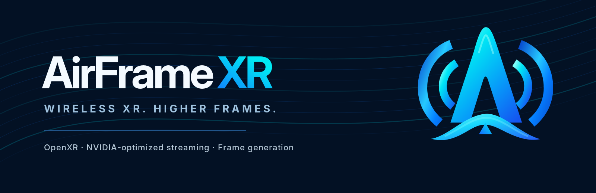
</p>

<!-- AirFrameXR overview: editorial refresh -->
# AirFrameXR

**Wireless PCVR for people who want high performance and simplicity. Re-engineered for NVIDIA. No SteamVR required. Optional integrated frame generation.**

<p align="center">
  <a href="https://youtu.be/8F8zQXMi9BA"></a><br>
  <sub>Watch the 2-minute overview (YouTube). Narration is synthetic; charts use the maintainer's measurements.</sub>
</p>

**Questions, profiles, test reports: join the [AirFrameXR Discord](https://discord.gg/T2jQep5h6).**

AirFrameXR replaces the **SteamVR + traditional ALVR PC streamer** with a **lean, NVIDIA-optimized OpenXR runtime and streaming pipeline**. It handles frame pacing, optional frame generation, NVENC encoding, and wireless delivery together, instead of layering those components on top of SteamVR.

**The headset side stays the same:** AirFrameXR speaks the **ALVR v20 protocol**, so you keep the existing ALVR headset client. The Windows streamer is NVIDIA-only; it has been tested on **Apple Vision Pro** and **Meta Quest 3**. Other ALVR-protocol clients may work, but are not verified here.

For the Quest there is a dedicated **AirFrameXR Quest client** ([releases](https://github.com/jfbobier/airframexr-metaquest/releases), version 1.3.0): a Vulkan fork of ALVR 20.14.1 with a welcome panel and a floor-height offset. **Controllers only, there is no hand pinch input** (it was not reliable and was removed, as on the Vision Pro client). It was tested on a Quest 3 only; the Meta-store ALVR client keeps working.

<p align="center">
  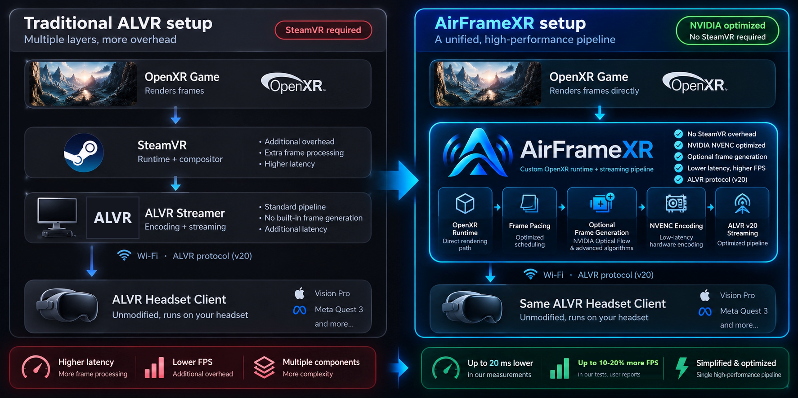
</p>

### The difference at a glance

| | Traditional PC-side ALVR setup | AirFrameXR |
|---|---|---|
| Runtime | SteamVR runtime and compositor | Dedicated OpenXR runtime based on VirtualDesktop-OpenXR (VDXR), with OVRShim |
| Streaming | Separate ALVR PC streamer | Integrated streaming pipeline using ALVR server components and protocol v20 |
| Encoding | General-purpose ALVR configuration | NVIDIA-specific NVENC HEVC 10-bit path |
| Frame generation | Requires a separate approach if desired | Optional, built into the frame pipeline with NVIDIA Optical Flow and edge-aware synthesis |
| Headset | ALVR client | **Same ALVR client — no custom headset app required** |
| Compatibility priority | Broad SteamVR ecosystem | Lean OpenXR-first path; **OpenVR-only titles go through the bundled [OpenComposite](#openvr-only-games-opencomposite) translation** (one switch in the launcher), the rest need SteamVR |

### Why build it this way?

AirFrameXR is built for people with a wireless headset and an NVIDIA GPU who want their games to run fast, without a pile of settings to learn.

- **A leaner engine.** Games talk to [VDXR](https://github.com/mbucchia/VirtualDesktop-OpenXR), a fast, small OpenXR runtime, instead of the SteamVR runtime and compositor.
- **One runtime, minimal copies.** Composition, frame pacing and encoding run in one pipeline that passes frames in shared GPU memory, with no extra copies between programs.
- **A proven network layer.** [ALVR](https://github.com/alvr-org/ALVR) provides the networking, encoding and decoding that a large community has stabilised, and the headset only needs the ALVR app. **Meta Quest** and **Apple Vision Pro** are the tested headsets.
- **Made for NVIDIA.** NVENC HEVC 10-bit encoding, and **split encoding** that uses all of the GPU's NVENC units instead of one (the RTX 5090 has three), tuned with the pacing and the network.
- **The game renders only what you see.** One choice for every headset: the vendor's own view (Apple, Meta: the default) or a restriction, a rectangle the game is told. *AVP optimized* is a window measured on a Vision Pro and is always in the list; your own takes about a minute in the headset (four bright lines, one eye at a time). A game that renders less is a faster game, and the saving can be spent as render quality. See [How FOV restriction works](#how-fov-restriction-works).
- **Frame generation in the pipeline.** Optional GPU optical-flow interpolation with an edge-aware synthesis (the edge technique comes from [VectorXR](https://github.com/DienerTech/vectorxr), re-implemented) can improve displayed smoothness when a game cannot sustain the headset's refresh rate. It is experimental, off by default and **can add interpolation latency**; it is not a free FPS boost.
- **Measure per game.** Game statistics record fps, latency, network and GPU for each game you play.
- **Less guesswork.** The setup wizard reads what your headset supports, offers a community profile (shareable as a JSON file) and tests the result on your PC and network.
- **Native Windows tools.** One launcher and native windows for the streamer, statistics, diagnosis and setup, plus an optional desktop mirror you can use from inside the headset.
- **Keep it simple.** Portable distribution, readable settings, targeted tools, and no attempt to be a general-purpose SteamVR replacement.

### Performance: measurements, not promises

**In the maintainer's tests of the new pipeline, gains of up to 10-20 % more FPS and up to about 20 ms lower latency were observed** in some games compared with the earlier SteamVR + ALVR path, and users report similar numbers (for example Enshrouded: about 45 fps here against 35-40 with SteamVR, on one user's own reading). These are observations from tested configurations, **not guaranteed gains**: they vary with the game, headset and network, and in some setups the two paths are at parity. Frame generation should be evaluated separately: it improves delivered/displayed cadence in some GPU-bound cases, but has its own latency trade-off. See the performance findings and testing harness below for technical context.

<!-- End AirFrameXR overview -->

> [!WARNING]
> **TEST AT YOUR OWN RISK.**
> On real headsets it has been tested by a small group of testers (the maintainer's own PC, an RTX 5090, with a Vision Pro and a Quest 3, frame generation included, plus automated tests on a laptop GPU). Games may crash, fail to start, or show a broken image; the stream may stutter or have high latency. It changes your PC's OpenXR runtime registration and adds a firewall rule
> (both undone by the launcher's OpenXR runtime button, "Switch back"). Keep comfort in mind: a frozen or juddering image in a headset can cause
> discomfort; take the headset off if anything looks wrong. Provided "as is", without warranty of any kind (see [LICENSE](LICENSE)).

**Main focus:** the **Windows** streamer on an **NVIDIA** GPU (RTX 40 series or newer recommended; any NVENC 12.2 driver runs), with an **Apple Vision Pro** or a **Meta Quest 3** (the AirFrameXR clients, or the stock ALVR app 20.14.x). That is what is built, tuned and tested here.

This is a **personal project**. It targets NVIDIA because that is what I run, and the Apple Vision Pro and the Meta Quest 3 because I own these headsets.
It is not affiliated with or supported by NVIDIA, Apple or the ALVR project.

**Relationship to ALVR.** AirFrameXR implements the ALVR streaming protocol (version 20) so that the existing ALVR headset apps work with it, and it is
built on ALVR's open-source server libraries (MIT). It is a separate project: it is **not ALVR**, not affiliated with or endorsed by the ALVR
project, and the ALVR developers' own streamer remains the place for SteamVR-based streaming.
- **Headset clients.** The streamer speaks the ALVR protocol (20.14.x), so there are two kinds of clients:
  - **AirFrameXR clients**, built for the two headsets this project targets, so that the optimizations run end to end (the field of view limit, the chroma-key passthrough, timing and latency logs):
    - **Apple Vision Pro**: the [AirFrameXR visionOS client](https://github.com/jfbobier/airframexr-visionos) (source on GitHub), distributed through **TestFlight**. <!-- TODO: add the public TestFlight link from kteque -->
    - **Meta Quest 3**: the [AirFrameXR Quest client](https://github.com/jfbobier/airframexr-metaquest), a full **Vulkan** rewrite of the ALVR client's renderer; **sideload** the APK from the fork's [releases](https://github.com/jfbobier/airframexr-metaquest/releases) (tested on a Quest 3 only).
  - **The stock ALVR clients** (the ALVR app on the Vision Pro, the Meta-store ALVR app on the Quest) work natively with the streamer, frame generation included, but with fewer end-to-end optimizations.

  Other headsets with an ALVR client (Pico, ...) are not targeted for now.
- **A plain colour when the headset connects, before a game starts, is normal**: it is the streamer's idle frame while no game runs. What you see there is your choice, made in the setup wizard and the streamer: the **desktop mirror** (a floating Windows screen, on by default) or **chroma-key passthrough** (your room: on the Vision Pro, turn on the ALVR app's **Enable Chroma Keyed Passthrough**; the key colour is #00FF00 and the idle frame follows it). Passthrough is optional and off by default; with it off the idle frame is black. If you chose passthrough and the headset shows plain green, the chroma key is not set in the ALVR app. Details: [docs/INSTALL.md](docs/INSTALL.md).
- **AMD / Intel GPUs**: not supported and not planned. The encode path is NVENC only; you are welcome to fork and adapt it.
  [ALVR](https://github.com/alvr-org/ALVR) itself supports them.

This project **does not aim to compete with existing commercial applications**. It offers **more options to the VR community**, using the
already open source [ALVR](https://github.com/alvr-org/ALVR) as the infrastructure.

> [!NOTE]
> **Game compatibility is not the goal.** AirFrameXR is a lean, low-latency path for the games that work with it; it does not aim
> to run every VR game. **For a game that does not work, use SteamVR + ALVR**: SteamVR is excellent at compatibility and at
> configurability, and this project does not try to compete with that. In testing, the vast majority of **UEVR games**, the
> **Luke Ross mods** and **native OpenXR / VR games** worked, but some games still have controller problems, crashes or both.
> OpenVR-only games: turn on the launcher's **OpenComposite (OpenVR) translation** switch ([below](#openvr-only-games-opencomposite)); a game it cannot run needs SteamVR.

#### OpenVR-only games: OpenComposite

AirFrameXR itself only speaks OpenXR. For older OpenVR games it ships [OpenComposite](https://gitlab.com/znixian/OpenOVR) (GPL-3.0-or-later; also on [GitHub](https://github.com/QuestCraftPlusPlus/OpenComposite)), which translates OpenVR calls to OpenXR, so those games run on AirFrameXR without SteamVR. In our tests it worked
on about 60 % of the "old" OpenVR games we tried. In the launcher, turn on **OpenComposite (OpenVR) translation**: OpenVR games then load the copy in the `opencomposite\` folder of the package; turn it off and the
system-wide OpenVR runtime goes back to what it was (SteamVR). It takes effect at the next game start. Games that still fail need SteamVR + stock ALVR.

OpenComposite is a separate program: its two DLLs ship unmodified with the source they were built from and the licence texts (`opencomposite\SOURCE.txt`, `docs\licenses\`); AirFrameXR does not link to them, it only changes the OpenVR runtime path.

How it is built: the headset's ALVR app sees an ordinary ALVR 20.14.1 server; in between there is no SteamVR compositor, no extra frame copies
between processes, and an encode path written for NVENC only.

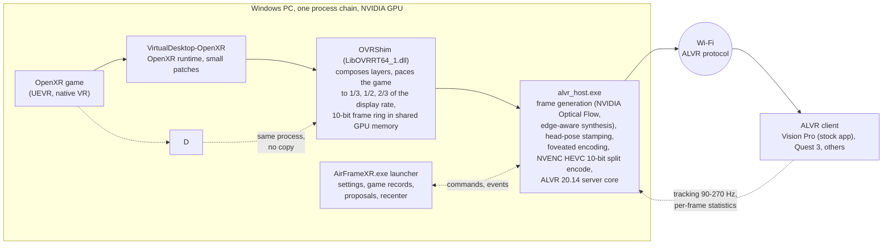

## What it looks like

The windows, at 1080p and 125 % scale, rendered by the project's own UI harness with demo data (a made-up game history and headset, no real person's data).
Regenerate them with `python3 harness/readme_screens.py`.

**One front door.** Double-click `AirFrameXR.exe`: a card per tool (the streamer, game statistics, settings, the advanced video and performance settings, diagnostics and headset setup) and, at the bottom, two small switches: **OpenXR runtime** (AirFrameXR, or back to the one you had) and **OpenComposite (OpenVR) translation** (OpenVR games on AirFrameXR, or back to SteamVR). Reviews of the OpenXR layers and the firewall rules appear there when something needs attention. The field of view the games are told (stock vendor view, or a restriction from one of your profiles, with its calibration) is at the top of the advanced settings: set once and forgotten.

<p align="center">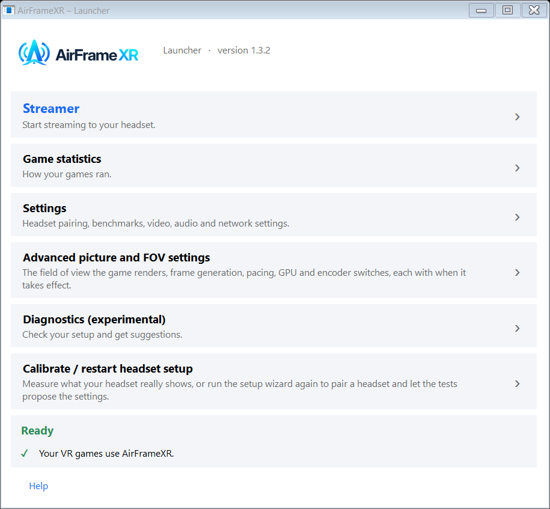</p>

**The streamer.** Three live tiles (the game's fps, what the headset shows, the latency), a line under them with the streamed fps, the bitrate and the packets lost, then **Features**: frame generation (x1.5, x2 or x3, or Auto) and the optional desktop mirror, aligned switches; gamma and sharpening, eye height and Recenter. The menu in the header (the three bars) opens the main menu, the game statistics and the advanced settings.

<p align="center">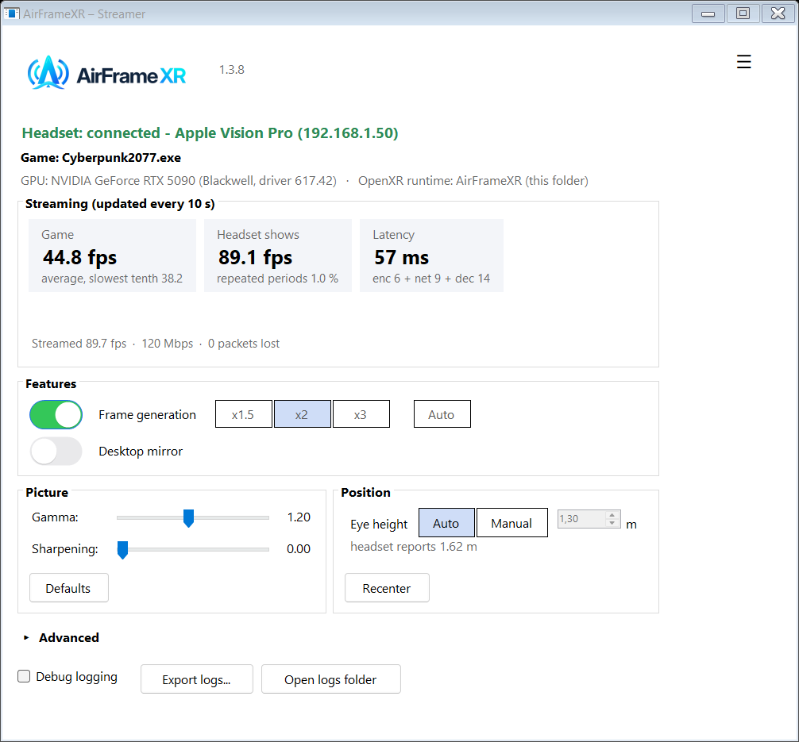</p>

**What happened in each game.** One record per game. The last session is drawn from the game (left) to the headset (right): its fps, the frame generation, encode, network and decode times, what the headset shows, and the latency split into its parts. Trend charts over the last sessions (fps, latency, repeated frames), the last run over time from the general log (fps, generation lag, GPU memory, how early frames arrive), the session history, and a log export.

<p align="center">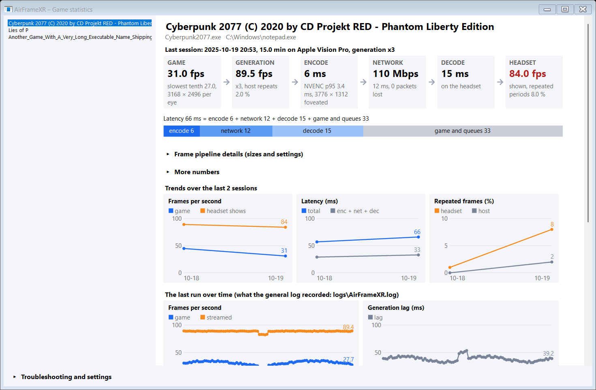</p>

**Diagnose, with suggestions.** The wizard's checks on your settings as they are, and a list of suggestions taken from [docs/PERFORMANCE_KNOBS.md](docs/PERFORMANCE_KNOBS.md): each says what it measured (this run's tests, or your logs and game records) and which knob it is about. Nothing changes unless you press a button.

<p align="center">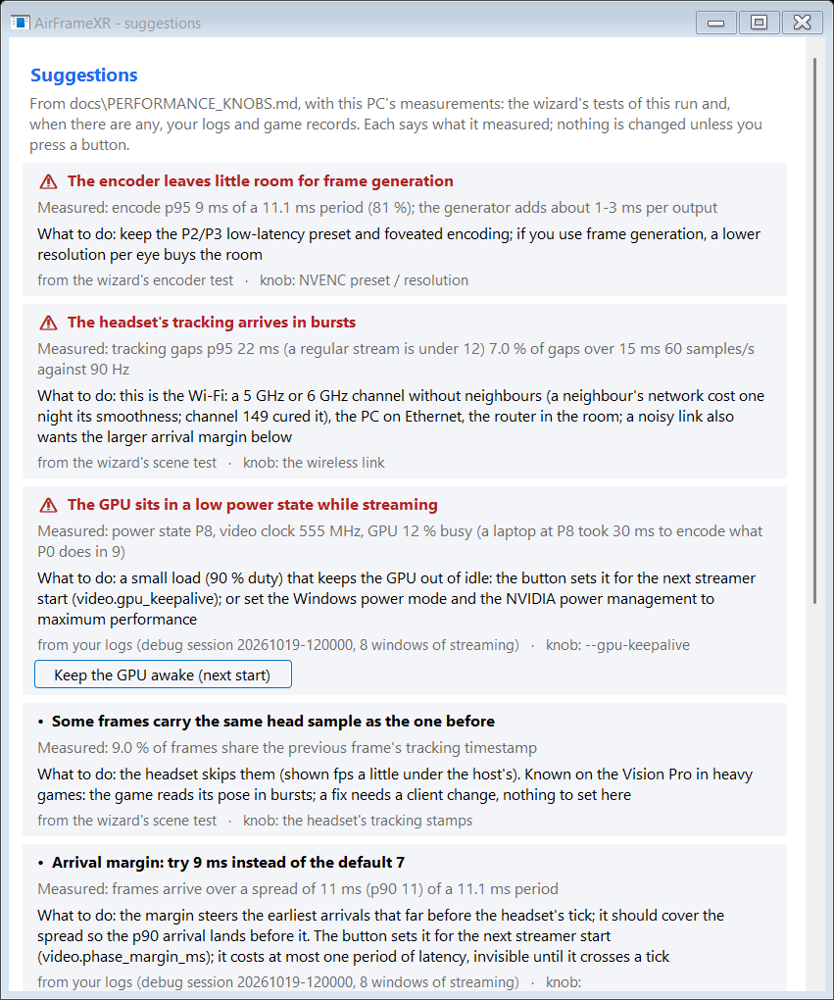</p>

**Setup, once.** The wizard reads what the headset supports, offers a community profile, a pre-filled manual setup or your existing ALVR settings, then tests the result.

<p align="center">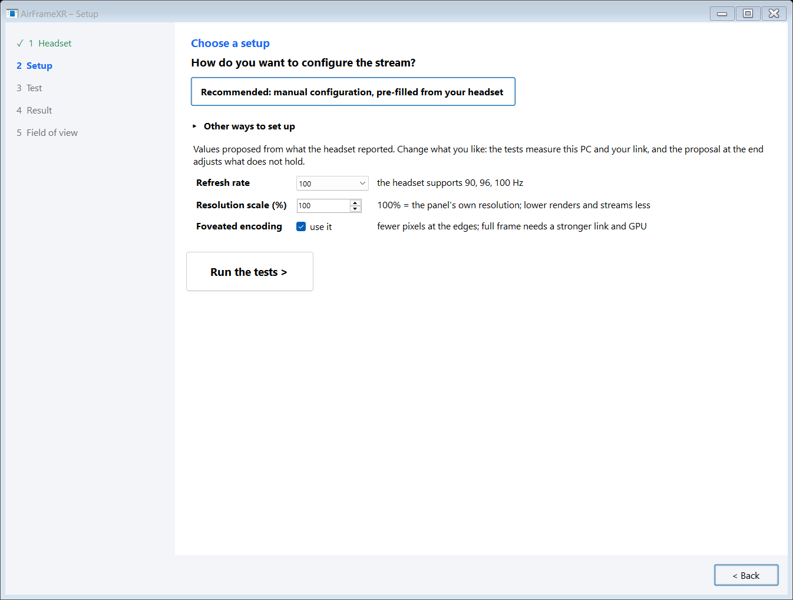</p>

**Your field of view, your profiles.** *Manage profiles and calibrate...* opens the profile manager (in the field of view section at the top of the advanced settings): every calibration you keep and every set of values you type is stored in `config\user_fov_profiles.json`, apart from the settings, so an upgrade does not lose it. Pick one to see its map (the headset's own box dashed, your measured window with its rays), delete the bad ones (a lot of people do not calibrate well the first time), enter values by hand (red when the numbers cannot be a field of view, yellow when they can but look strange), import a file someone shared, or check one with `fovgrid` in the headset. The standard Vision Pro calibration, and a starting point for the Quest 3 (about 10 % fewer game pixels, from one published measurement, not tested here), are copied in for the matching headset.

<p align="center">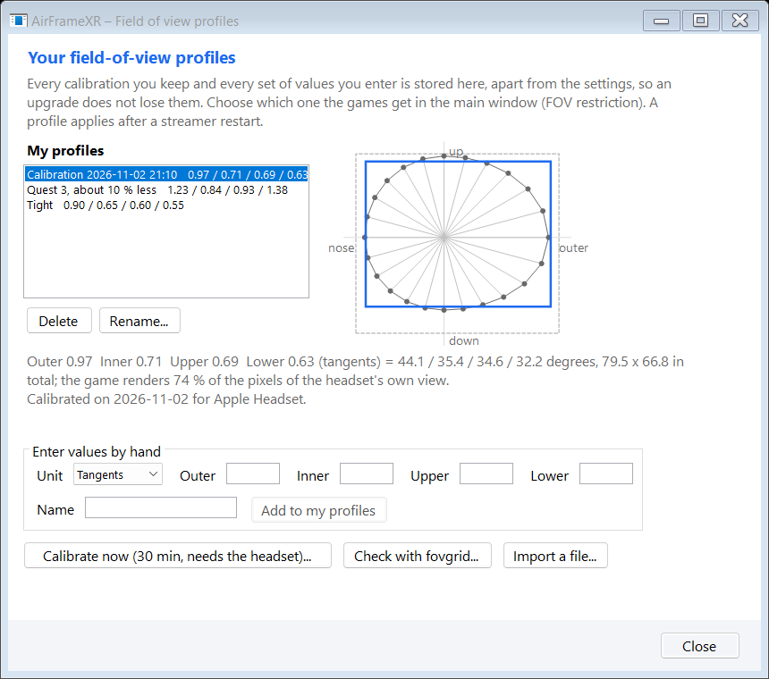</p>

**Calibrate your own field of view.** *Manage profiles and calibrate...* > *Calibrate (1 min, headset on)* starts a scene in the headset: four bright lines mark the edges of the picture, one eye at a time (close the other). Press SPACE to start. Look at a line and push it outward with the arrow keys until the lens cuts it and it disappears, then bring it back until it is clearly visible again (Shift + arrow moves it back); **Enter** ends the eye, and Enter on the second eye saves. On a Vision Pro the lines start on the AVP optimized window, on another headset at 85 % of what it declares, and they never go past what the headset declares. The keys are read from the PC keyboard while the calibration window is in front (the tool stops the desktop mirror and takes focus, so nothing moves the Windows mouse). The result is kept in your profiles as the larger value of the two eyes on each edge, because the engine tells the game one box for both eyes. Same tool for every headset. The 1.3 ray wizard (30 minutes) is gone from the interface; its maths stay in [docs/FOV_CALIBRATION.md](docs/FOV_CALIBRATION.md).


*The picture shows made-up demo data from the UI harness (invented profiles and windows, not a person's measurement).*

**In the setup wizard.** The last step asks for the field of view with the same two choices: *Stock vendor view* is the default, and what you pick there is what is used afterwards (*AVP optimized*, a profile of yours, or values typed by hand). The passthrough question comes earlier and defaults to Yes for the Vision Pro and the Quest alike.


**Firewall rules.** Finds the rule for this folder's exact `alvr_host.exe`, offers one only if none is in place, and lists the leftovers Windows keeps (stale, duplicate, blocking) with one click to remove them.

<p align="center">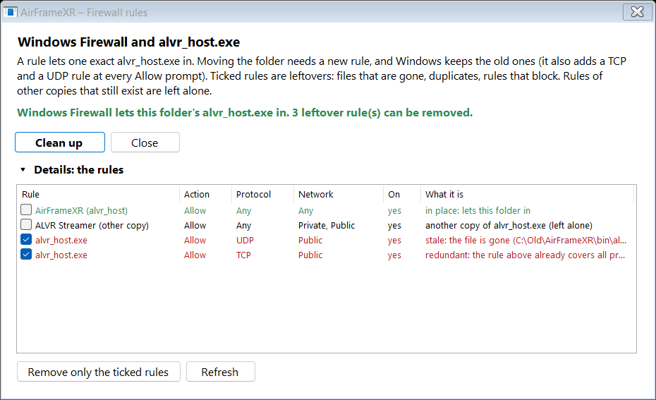</p>

<!-- AirFrameXR desktop mirror illustration -->
**Desktop mirror (optional).** Between games, the Windows desktop can float in front of you in the headset, and a controller is the mouse: the orange beam points, trigger clicks, A / X / B / Y double-click, the thumbstick scrolls, a grip puts the screen back in front of you, and a "? controls" badge under the screen shows these on hover. Start the next game from where you sit, without removing the headset or looking at the monitor. The right controller holds the beam; **left-handed**, press the left trigger and the beam is the left controller's (press the right one to give it back). It is a switch in the streamer, and an alternative to chroma-key passthrough as the idle view. The beam and the mouse follow a controller only once it is confirmed in use (an input from it, or an aim that moves away from the head): without VR controllers there is no ray from the head.

<p align="center">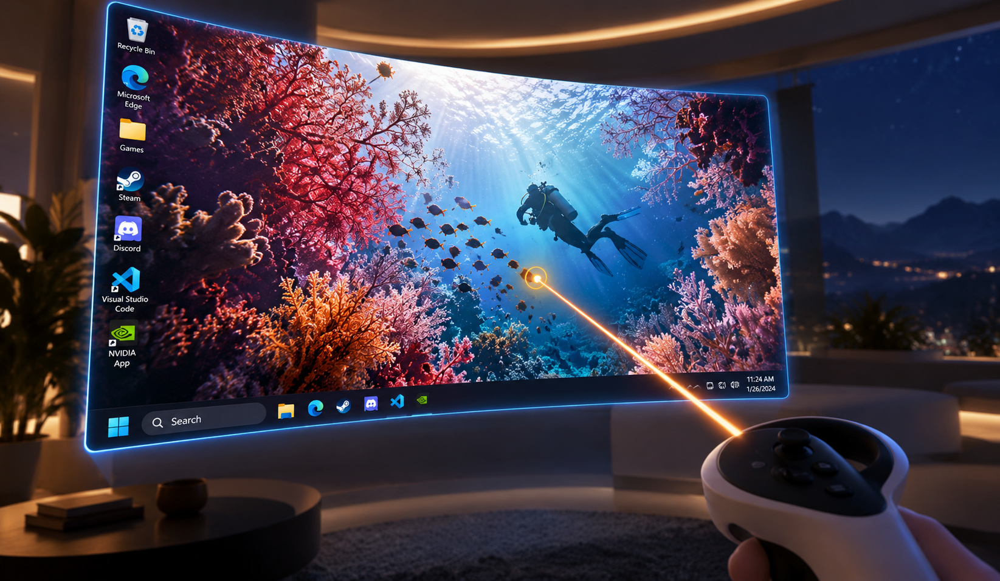</p>

*Illustration (generated artwork based on a real desktop capture, not a headset screenshot; the real screen is flat and floats over your room or the idle colour).* The picture the headset gets is also tested on the GPU for 7 desktop shapes in SDR and HDR (see the harness below).

<!-- End desktop mirror illustration -->

## Black Box: the performance suite


When a game stutters, the first question is *where does the time go*: the game, the encoder, the network, the GPU? The **Black Box** answers it without touching how you normally stream.
It is a **performance flight recorder** and an analyzer, in a separate install that ships inside the download (the `blackbox\` folder, started by `blackbox_perf.exe` in the root). Most late frames come from the game itself (DLSS quality,
ray tracing, resolution), so the report says so when the stream waited for the game and the GPU was busy.

**Black Box Recorder** (`blackbox_recorder.exe`) is the streamer window with a recording panel. It copies your normal streamer's settings and headset pairing when it starts (one way: your normal
folder is never written), then records:

- on a key, **F8** by default (configurable; the game never sees the key), or
- for a **full session** (tick it once): from the game's start to its close, for games where the problem shows up an hour in.

While it records it samples the GPU (utilisation, clocks, power, temperature, VRAM, power limiter, encoder), the Windows counters (CPU, memory, network, the GPU engines of the game and the
streamer), and keeps the streamer's per-frame files, into `logs\performance\<time>_<scene>\`. **The OpenXR runtime.** Windows has one active OpenXR runtime and a game loads it, so to record a game the Black Box must be that runtime while you record (it is the telemetry build).
The recorder explains this when it starts and offers the switch; it remembers the runtime that was active and a button (**Put back ...**, also offered when you close the window) puts that exact
one back. Each switch asks Windows for administrator rights, because the setting is machine-wide. An optional **Deep trace (admin)** button records GPU and CPU scheduling for 20 s with Windows'
own recorder (one more permission prompt; declining changes nothing).

<p align="center">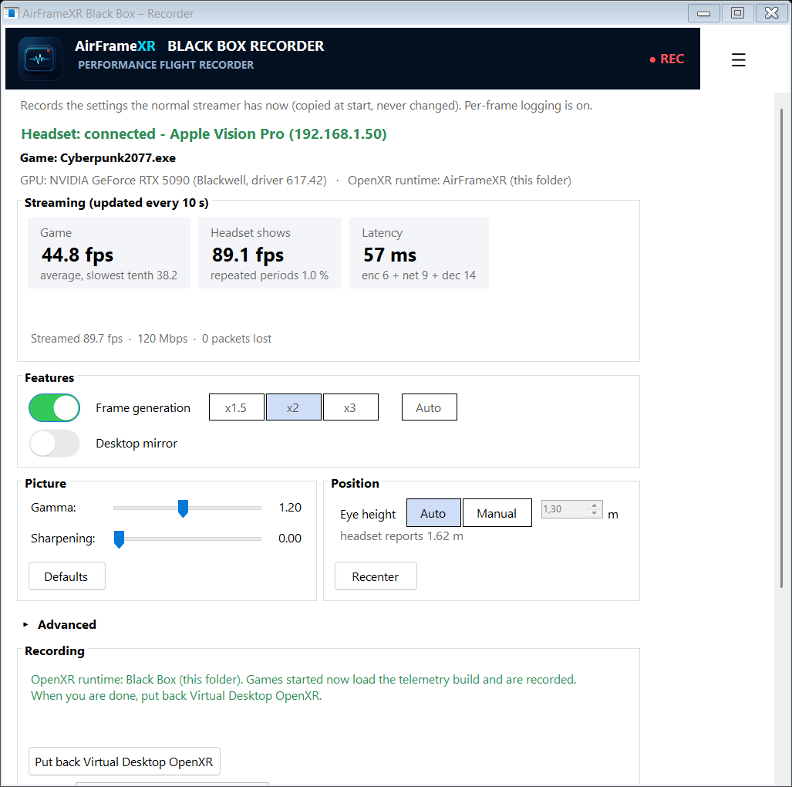</p>

**Black Box Analyzer** (`blackbox_analyzer.exe`) is a separate program you run afterwards. Nothing is analyzed until you click. It gives one **verdict** that names the resource at fault, then lists the
results **by resource, in the order a bottleneck is looked for: GPU, CPU, memory and I/O, network, VR rendering**. Each metric has an **average** and a **worst** value (the 99th percentile of a load, the lowest
value of a clock or of free memory), and each category has a status and a **time series** on a shared time axis, with the late frames marked above the first chart. Every line is drawn as a percentage of its own
limit (the frame period, 100 % load, all the cores, all the RAM, the display rate), so a GPU load and a network latency in milliseconds share one scale; hover to read the real values at that second in every chart.
It also shows the worst 10-second windows of a long session (when it went bad) and the worst late frames, replays old recordings, exports a recording as a zip, deletes old ones, and opens a recording from
another PC. It refuses to analyze while a recording is running, so it never competes with your game for the CPU.

<p align="center">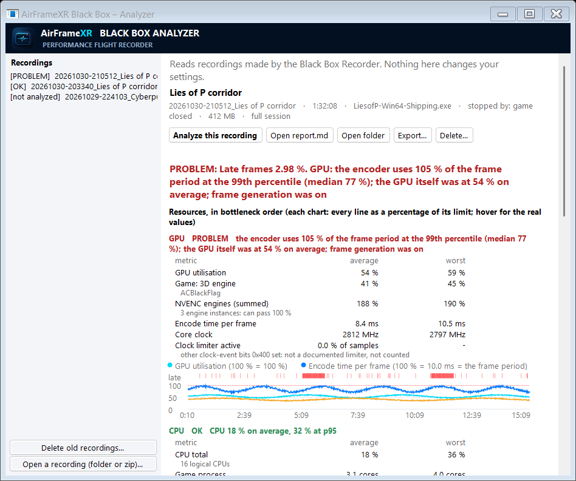</p>

*(The windows above are rendered by the project's UI harness with made-up demo data, not a real recording.)*

**How to use it.** Close the normal streamer (one headset, one port), start `blackbox_perf.exe` (in the root of the folder) and open the Black Box Recorder, which asks to become the OpenXR runtime for the recording (see below), connect the headset and start the game, press F8 (or tick
*Full session* first), play the scene that stutters, press F8 again, then open the Analyzer and click *Analyze*. To test other streamer settings, change them in the normal streamer, then come back.

**Why it is a separate install.** Per-frame logging costs CPU, so the normal streamer is built without it: it never writes a per-frame record and never asks for administrator rights. The Black Box is
the same code built with the telemetry on, so a diagnosis never changes the numbers of everyday streaming ([how it is built](docs/ARCHITECTURE.md#telemetry-and-the-black-box)).

**What has been tested.** On the lab rig (RTX 3080 Ti laptop): the probe and the report against generated sessions with known faults and known non-faults, the recorder's file handling, and the windows at
1080p, 1440p and 4K at 100-200 % scale. The probe's own cost against the pacing lab: invisible at 1 Hz, +0.25 ms at the 95th percentile at 5 Hz. **Not yet tested: a recording in a real headset session**
(F8 in real games, a full session, the Deep trace). Treat the first verdicts as a first reading and tell us what you see. Design, measurements and the test matrix: [docs/TELEMETRY_PLAN.md](docs/TELEMETRY_PLAN.md),
[docs/BENCH_UI.md](docs/BENCH_UI.md).

## Features
- **Setup wizard** (`configure.exe`): reads what the headset supports, offers a community profile, a pre-filled manual configuration or your existing ALVR settings, then
  tests the result (system and NVENC, encoder speed, network at the configured bitrate, a real scene streamed through the pipeline with the headset's own head pose, audio).
  **Find headset...** in the streamer window searches the network and pairs. Any NVIDIA GPU with NVENC API 12.2+ works.
- **Frame pacing** with an intake gate and a three-deep in-order queue. The Vision Pro profile defaults to foveated encoding at 300 Mbps.
- **Frame generation** (off by default, a switch in the streamer and in Settings; experimental): for games that cannot hold the display rate. A slider sets the game's rate as a
  fraction of the display rate, **1/3, 1/2 (default) or 2/3**, and the streamer generates the frames in between. In-scene motion comes from the GPU's optical-flow engine
  (NVIDIA Optical Flow, Turing or later), the synthesis is edge-aware (motion edges stay sharp, and where the motion is uncertain the real frame is shown instead of a double
  image; ideas from [VectorXR](https://github.com/DienerTech/vectorxr), re-implemented; the earlier algorithm stays as **classic** in Advanced video and performance settings), and
  every output is rotated to the newest tracking sample. Verified on a Vision Pro at 100 Hz with an RTX 5090: missed display periods 38 % -> 1 % at half rate; also run on a Quest 3.
  It costs latency by construction (interpolation: one game period), and it is not automatic by design: a game that holds a steady 70-75 fps is often better left alone.
  A **Recommended** tick sets the rate from the game's recorded runs on the connected headset, and **Recenter** (a button and a key, **End** by default; also sent at every game start) turns the tracking space to your
  current forward. See [docs/FRAME_GENERATION.md](docs/FRAME_GENERATION.md), [docs/FRAME_GENERATION_UNCAPPED.md](docs/FRAME_GENERATION_UNCAPPED.md), and
  [docs/PERMANENT_RECORD.md](docs/PERMANENT_RECORD.md) (archive) for why DLSS motion vectors were tried and removed.
- **A field of view for the game, set from the streamer**, the savings shown against what the game would have rendered, a percentage to spend them on quality, a one-minute calibration in the headset (four lines per eye) and, on a Vision Pro, a foveation computed from Apple's rate map and your choice: [how it works](#how-fov-restriction-works).
- **The windows** (above): one launcher, the streamer, Logs and performance, Diagnose with suggestions, the wizard, the field of view calibration, the firewall and OpenXR-layer reviews. They follow the display
  (1080p laptops to 4K, 100-200 % scale), checked by the UI harness below.
- **Desktop mirror** (optional): see above; it works with either hand.
- **Advanced video and performance settings**: the switches that change the picture the game renders and the timing, for people who measure. Each one says when it takes effect and what we
  measured; a switch at its default is removed from the settings file. The HEVC QP map stays on by default and its trade-off is written next to it.
- **Black Box** (a separate install inside the download): a performance flight recorder and analyzer for one game, [see above](#black-box-the-performance-suite).
- **Lab tools**: the test harness below, including a frame generation judge ([docs/FRAME_GENERATION_JUDGE.md](docs/FRAME_GENERATION_JUDGE.md)) and the QP map A/B.

What changed in each version: [docs/releases/](docs/releases/) (1.0 onward; earlier notes are in the GitHub releases and the archive). `docs/progress.md` is the current status: what is built, what is tested (and how), what is not. Older history: [docs/PERMANENT_RECORD.md](docs/PERMANENT_RECORD.md).

## Status
- **Works on the real headset** (tested on RTX 5090 + Vision Pro, and on a Quest 3 with the Meta-store ALVR client): the vast majority of
  UEVR games, Luke Ross mods (Dead Space Remake), native VR games, controllers (ALVR's Quest/Touch emulation), haptics, game audio,
  discovery/pairing with the stock app.
- **Known issues**:
  - Some OpenXR games need the SteamVR + ALVR fallback. OpenVR games are not supported natively: the bundled OpenComposite translation worked on about 60 % of the old OpenVR games we tried (see above); the rest need SteamVR.
  - No USB streaming, except when bridged with ALVR's own tools.
  - HEVC encoding is baked in for maximum split-encoding performance: no H.264 or AV1.
  - The diagnostics tool is still experimental: for example, its network bandwidth assessment is still reported as not reliable.
- **Perceived quality varies a lot from one setup to another, especially with frame generation on.** Every time the same build felt different on the same PC and headset, the
  cause was a condition of the setup, not a game: the Wi-Fi channel (a neighbour's network produced micro-stutters that stock ALVR showed too; channel 149 cured them), the panel
  running 100 Hz instead of 90, the margin frames need before the headset's tick (7 ms is the default), the generation rate per game, the Quest tracking at 270 Hz being read as
  a 241 Hz display. All of these are measured and most are handled, but a new PC, router or headset will find the next one. If something feels off, the logs usually say why; see
  [docs/PERFORMANCE_KNOBS.md](docs/PERFORMANCE_KNOBS.md) for every knob, what it does and what should drive it, and
  [docs/PERFORMANCE_FINDINGS.md](docs/PERFORMANCE_FINDINGS.md) for the nights that taught us.
- The benchmark that picks settings for your PC + router + headset is half built: the headless quality sweep works (`docs/BENCHMARK_DESIGN.md`); the headset phases and applying
  the results are next. Measured on a 1-NVENC laptop GPU and a 5090.

## How FOV restriction works

**What a field of view is.** A headset image is a window onto the world, and OpenXR describes the window by four angles from the eye's view axis to its edges: left, right, up and
down (`XrFovf`). Renderers use their tangents, because a flat projection is linear in the tangent: the picture is a rectangle spanning `tan(left) + tan(right)` across and
`tan(up) + tan(down)` down, and a pixel density is "pixels per unit of tangent". The four angles are rarely equal: the nose side is smaller than the outer side. The Vision Pro's app
declares (left eye, the right is its mirror, outer = away from the nose):

| Edge | Outer | Inner | Up | Down |
|---|---|---|---|---|
| declared angle | 60.8 deg | 45.6 deg | 50.6 deg | 45.6 deg |
| declared tangent | 1.79 | 1.02 | 1.22 | 1.02 |

That is 106 x 96 degrees, with a recommended image of 3552 x 3200 per eye. The Quest 3 declares 94 x 99 degrees and shows all of it. The Vision Pro does not: measured with a grid
([docs/AVP_FOV.md](docs/AVP_FOV.md), one person, left eye, a first estimate) it shows about 80 x 74 degrees of the 106 x 96 it declares (tangents 1.69 x 1.49 instead of
2.81 x 2.24), so about half the pixels of the frame land outside what you can see.

**How games use it** (we read UEVR's OpenXR path to see). An OpenXR game asks the runtime two things when it starts. `xrEnumerateViewConfigurationViews` returns the recommended image
size per eye; `xrLocateViews` returns, with each eye's pose, the four angles. UEVR builds its projection from those angles, creates the swapchain at the recommended size (times its own
resolution slider), renders, and submits a projection layer carrying the same angles and size. It does not use a visibility mask, and nothing in the handshake announces a change
later, so a game takes these values once, when it starts. The runtime reads them once too (VDXR latches them at system creation). The consequence is the lever: **the game renders
what it is told it has**. Tell it a smaller field of view and a proportionally smaller image, and a GPU-bound game does less work.

**How AirFrameXR uses it.** The headset's real window is the contract with the client: the Vision Pro app maps the stream frame over the field of view it declared, so the frame
must keep covering all of it. Only the game is told something else. With the Vision Pro, the frame flow is:

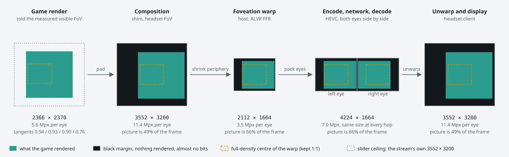

1. **The headset declares its views** when it connects (the app sends the render frustum, `views_config`). The host saves them in `config\airframexr_views.json`; the FOV card in the launcher
   uses them to offer only the profiles that fit.
2. **You choose what the game is told**: in the launcher's field of view card, pick *FOV restriction* and a profile (four tangents: outer, inner, upper, lower). A copy of
   the profile goes into `airframexr.json`; the values are never more than the headset's. For the Vision Pro, [docs/AVP_FOV.md](docs/AVP_FOV.md) gives the visible window and the calibrated values that fit it (0.97 / 0.71 / 0.69 /
   0.63, the standard calibration copied into your profiles). The host turns them into per-edge fractions of the headset's tangents and publishes them to the shim.
3. **The shim answers the game** at its next start: `GetEyeFov` returns the restricted angles, and the recommended size is the stream's eye size scaled by the restricted span on
   each axis (about 2800 x 2500 for the row above with the AirFrameXR client's own visible limit declared, about 68 % of the pixels: computed, not measured). The game renders that, with the restricted projection.
4. **Composition puts it back where it belongs.** The shim maps the game's layer into a frame that covers the headset's whole field of view (3552 x 3200 per eye), the margin the game
   did not render stays black, and the picture sits where those angles fall in the frame.
5. **The foveation warp, encode, network and decode do not know.** Both eyes go through ALVR's foveation warp into one 4224 x 1664 frame and through NVENC as before. The black
   margin lies in the periphery, which the warp shrinks the most, so it is 51 % of the composed frame but 34 % of the stream frame, and black blocks cost almost no bits.
6. **The client unwarps** and maps the frame over the declared field of view, as always. The margin shows as black at the edges, outside what the lens shows anyway (for the values
   above).

So the saving is the game's GPU work only; encode time, bitrate, decode time, frame generation and the headset app are unchanged. A game that is not GPU-bound gains nothing. The values
**need a streamer restart** (the FOV card in the launcher closes the streamer for you when you change one, and you start it again when you are done; a running game keeps the picture it started with, so unticking the restriction shows nothing new until then), and the override remembers the headset's field of view it was made for: connected to a headset whose field of view differs (a Quest after a Vision Pro), it is not applied and the window says so (on a Quest, a lower of 1.00 would cut its 55-degree
down edge); ticking again starts from the new headset's own values.

**Spending the saving: "Spend the savings on quality" (1.3.5).** The panel shows what the restriction saves: *without the restriction the game would render 3552 x 3200 per eye (11.4 Mpx); with it, 1628 x 1264 (2.1 Mpx), a saving of 82 %* (the numbers are yours: the resolution you declared in Settings, or the headset profile's own, 3552 x 3200 for a Vision Pro, over the box the game is told). Unticked, the game renders the least that matches the stream's own pixel density. Ticked, you choose a percentage of the pixels the same box would have at your declared resolution: **100 % is pixel for pixel with it** (about 2126 x 1886, 4.0 Mpx, still a saving of 65 %), the lowest value is the stream's density, and above 100 % (a second tick, "allow above 100 %") is supersampling up to the stream's own size (2720 x 2144 at 275 Mbps, 146 %): cleaner edges, more GPU time, no detail the stream cannot carry (about a thousand pixels per tangent at 275 Mbps). It is one number committed once (Enter, leaving the box, or a moment after you stop typing), not a slider that wrote the settings on every move. The percentage is turned into the engine's quality (a blend of the floor and the ceiling size) each time the stream size or the box changes; the engine blends the two sizes linearly, so the shape of the size differs a little from pixel for pixel at the same pixel count. A size you type in Settings is kept (the stream no longer follows the bitrate, the foveation is still computed for it; the *Automatic* button gives the bitrate's size back) and is also your declared resolution. A number box or a slider no longer changes by a scroll of the mouse wheel unless you have clicked into it: the wheel scrolls the page.

**The foveation follows your choice (Vision Pro, 1.3.5).** ALVR's foveation keeps a band of the frame at full density and compresses the rest. Apple's compositor already discards detail at the edges of the display (a rasterization map, static and identical on the two headsets measured). The launcher computes the band and the compression from that map and from your choice, and writes them into `session.json`: at each streamer start, when you save Settings and every time you choose a restriction. With no restriction the band follows Apple's map; with one, it is centred on your window (plus two degrees), since the game draws nothing outside it. **It is always milder than ALVR's own defaults** (a centre at least 10 % larger than 0.45 x 0.40, an edge ratio at least 20 % below 4 / 5), and it adds only about 60 % of what Apple's map already loses, so the edges stay clean (a first version compressed exactly as much as Apple does and looked over-compressed on a headset). The stream size follows your constant bitrate (the profile's 0.474 bits per pixel), never above Apple's own density or NVENC's width; a size or foveation numbers you type in Settings are left alone until the next choice. A Quest keeps the profile's numbers: there is no Meta map.

**Calibrate it yourself.** Launcher > field of view card > *Manage profiles and calibrate...* > *Calibrate (1 min, headset on)*: see *Calibrate your own field of view* above. The profile file format is in [docs/HMD_PROFILES.md](docs/HMD_PROFILES.md). New in 1.3.5; checked on the PC and in the lab, not yet on a headset.

**What is not known yet.** The visible window is one person's left eye at one fit of the headset; it moves with the seal, glasses inserts and IPD, so start from the recommended row
(visible + 3 degrees) and check the corners for black with `fovgrid.exe` ([docs/FOV_GRID.md](docs/FOV_GRID.md)). The Vision Pro profile carries the measured window and the suggested render quality (25 %), and they are copied into your profiles once for the matching headset, never applied by themselves ([docs/HMD_PROFILES.md](docs/HMD_PROFILES.md)). The feature is covered by lab scenarios (the app gets exactly the tangents
and recommended size, the margin is black, the picture sits inside it) and has not been tried in a real game. The bigger lever, spending the stream's own pixels on the visible window
only, needs the client to declare that window; the host alone cannot do it. Details and keys: [docs/EXPERIMENTAL_SWITCHES.md](docs/EXPERIMENTAL_SWITCHES.md).

## Game audio
The game's sound reaches the headset without installing anything: the host captures it with **Windows' process loopback** (everything the PC plays, taken before the output's volume and mute), so your Windows default output is left alone and games started as administrator are heard too. While the streamer runs it can mute your PC speakers (a checkbox in Settings, on by default) and puts the mute back when it closes. A virtual cable (VB-CABLE, a separate product) is the fallback, and the only way to get the headset's **microphone** into a game. Details, and what is not tested: [docs/INSTALL.md](docs/INSTALL.md#game-audio-and-headset-microphone).

## Requirements
- Windows 10/11, an **NVIDIA** GPU with a current driver (NVENC API 12.2+); RTX 40 series or newer recommended (several NVENC chips enable split encoding).
- An **Apple Vision Pro** or a **Meta Quest 3** with the AirFrameXR client (or the stock **ALVR** app, 20.14.x; see above); PC and headset on the same LAN (Wi-Fi 6 on 5 GHz for the first Vision Pro; 6 GHz is for newer models and Quest 3). Only these two headsets are targeted for now.
- **Wired connection**: a Meta Quest on USB works through **USB tethering** (the headset then appears to the PC as a network interface) or through [ADBForwarder](https://github.com/alvr-org/ADBForwarder) (ALVR's small adb helper; run it, open the ALVR app on the Quest, and use `127.0.0.1` as the headset address: the wizard shows a *Meta Quest on a USB cable?* link when nothing is found). AirFrameXR itself does not run adb. The Vision Pro Developer Strap works as a network link the same way.
- SteamVR and ALVR's own launcher closed while streaming (same ports).

## Recommended network setup
The stream is 100+ Mbit/s of low-latency video: the network matters more than the PC. What works best:
- **A Wi-Fi 6 (or newer) router dedicated to the headset**, in the same room (line of sight if you can). The first Vision Pro (M2) has
  **Wi-Fi 6 on 5 GHz only (no 6 GHz)**: use the 5 GHz band with a **160 MHz channel**. A 6E/7 router is fine, and the 6 GHz band is for
  newer Vision Pro models and the Quest 3. Put it in **dumb access point mode** (router functions, NAT and its own DHCP server off), wired
  by Ethernet to your main router or switch, so the headset stays on the same subnet as the PC and no second NAT adds latency.
- **PC on Ethernet** (not Wi-Fi), on the same network as the access point.
- **A fixed IP for the headset**: a DHCP reservation on your DHCP server (usually the main router) bound to the headset's **MAC address**.
  In visionOS, set *Private Wi-Fi Address* to Off (or Fixed) for this network, otherwise the MAC address can change and the reservation
  stops matching. A fixed address makes pairing and reconnecting reliable.
- Nothing else heavy on that access point while you play (downloads, other headsets).

## Install (users)
Download the release zip, unzip it anywhere and double-click `AirFrameXR.exe` (the launcher, the only file in the folder's root): switch the
OpenXR runtime to AirFrameXR once (one administrator prompt; the same button switches back), run the **Setup wizard** (pair the headset,
tests, settings), then **Streamer** (keep it open while you play). Details, settings and logs: [docs/INSTALL.md](docs/INSTALL.md).
The headset's address does not have to be fixed: AirFrameXR dials the saved address, finds a paired headset again by name on its own,
and the **Find headset...** button in its window searches the network, pairs a new headset or takes an address you type.
`configure.exe` offers a shared **community profile** for your headset (JSON files, import/export, see [docs/HMD_PROFILES.md](docs/HMD_PROFILES.md); the
starter Quest and Pico profiles are not verified yet), a manual configuration or your existing ALVR configuration, then tests the result on your PC and network.

## Build from source (contributors)
AirFrameXR builds **on Windows only** (MSVC, the Windows SDK and NVENC; cross-compiling from Linux is not supported). With the
prerequisites installed ([docs/DEVELOPMENT.md](docs/DEVELOPMENT.md): Git, Rust, CMake, LLVM, NuGet, Visual Studio 2022 with C++,
all available through `winget`, plus an NVIDIA driver):
```powershell
git clone https://github.com/jfbobier/AirFrameXR.git
cd AirFrameXR
powershell -ExecutionPolicy Bypass -File build.ps1
```
The first run fetches ALVR v20.14.1 and VirtualDesktop-OpenXR at pinned commits and builds them (10+ minutes, ~6 GB); the
result is the same portable folder and zip as the release, in `out\dist\`. An automated test harness (end-to-end scenarios with
a headless mock ALVR client, no headset needed) is described in [harness/README.md](harness/README.md).
See also [CONTRIBUTING.md](CONTRIBUTING.md).

## Repository layout
The host is Rust (`tools/host/`) on a C++ NVENC library (`nvenc/hostlib/`); the OpenXR side is `ovrshim/` (a fork of VDXR's sample driver); the windows are C# WinForms (`tools/gui/`); the test harness is Python (`harness/`). The full table is in [docs/DEVELOPMENT.md](docs/DEVELOPMENT.md#repository-layout).

## Relationship to upstream
Nothing is a long-lived fork: ALVR (v20.14.1) and VirtualDesktop-OpenXR are fetched at pinned upstream commits (`deps.lock.json`) and built with small, asserted patches, so an upstream change fails loudly instead of drifting. ALVR's encoder sources are vendored unmodified and patched at build time; `ovrshim/` is the one real fork (of VDXR's sample driver). What exactly is patched, and how much: [docs/UPSTREAM.md](docs/UPSTREAM.md).

<!-- AirFrameXR developer philosophy -->
## For developers: design philosophy

**Performance first. Complexity last.** AirFrameXR is deliberately narrow: a fast, lean OpenXR-to-headset pipeline, not a universal VR launcher. No feature bloat, one tool one job, native tooling where it fits, and measured improvements only. AI-assisted contributions are welcome with accountability (a work summary in `docs/ai-contributions/`). Read [the development philosophy](docs/DEVELOPMENT_PHILOSOPHY.md) and [CONTRIBUTING.md](CONTRIBUTING.md) before proposing changes. **This project will not become feature-bloated.**

## For developers: the testing harness

Everything above was tuned by one person and an AI agent working the same loop every evening: change, build on the PC, run the lab,
read the verdicts, then one headset session with the logs on. The lab is what makes that loop honest, because a headset session is one
person's eyes on one evening's Wi-Fi, and the lab is the same pipeline under conditions you choose, with a judge that does not get tired.

Nothing in the lab is a mock of the pipeline: the real host, shim, intake, clock, generator and encoder run; what is replaced is the game,
the headset and the network, each by something whose behaviour is known exactly, so that any defect in the picture is the pipeline's.

The pieces, in short: a **fake game** (a real OpenXR app with knobs for frame time, CPU and GPU cost and moving markers), a **fake headset** (a synthetic head that replays the timing imperfections of recorded real sessions, and a viewer that shows what the headset would), a **judge** that scores the picture the viewer displayed (head-rotation tremble, moving-marker judder, generated frames against a rendered ground truth) rather than host counters, named **scenarios**, a **live harness** that runs the same loop on the real headset, **stability** fault-injection and soak runs, and checks for the windows, the desktop mirror, audio, the firewall review and the field of view. The full table, with where each piece lives and how to run it, is in [harness/README.md](harness/README.md#lab-overview-what-each-piece-is).

How it is used: `python3 harness/simrig/run_sim.py build` once, then `run <scenario> --seconds 40`; results land in `harness/results/`. [docs/DEVELOPMENT.md](docs/DEVELOPMENT.md) has the recipe and the builder setup. A **debug build** keeps the per-frame telemetry the lab needs; a **release build** compiles it out (what a public release uses).

**Pull requests.** A change to anything on the frame path (shim, pipeline, generator, encoder, pacing) is accepted only with the lab's proof
in the description: the scenarios relevant to the change, their verdicts before and after, and the compile checks. "It looks fine in my
headset" is where this project started, and the harness exists because it was not enough. A PR that adds a scenario for the condition it
fixes is the normal case. A change to the GUI needs `harness/ui_matrix.py` to stay at 0 FAIL (see [harness/README.md](harness/README.md): the rules it enforces).

**Transferable.** Nothing in the harness is specific to AirFrameXR except the IPC it hooks. A fake game with controllable cost and exact
vectors, a fake headset replaying recorded tracking imperfections, a viewer that reprojects like a client, and a judge that measures the
picture rather than the counters, apply to any project that optimises the OpenXR-to-headset chain: another streamer, a compositor, a
frame-generation layer. Take it.

## Credits
AirFrameXR stands on the shoulders of giants: the projects below made it possible and gave it solid foundations to build on.
- **[ALVR](https://github.com/alvr-org/ALVR)** (MIT) by polygraphene and the alvr-org contributors: the foundational
  infrastructure this is built on, its streaming protocol, server core, networking, audio, foveated encoding and NVENC
  encoder code, and the [ALVR visionOS client](https://github.com/alvr-org/alvr-visionos) that runs on the headset.
  AirFrameXR exists because ALVR made wireless PC VR open.
- **[VirtualDesktop-OpenXR (VDXR)](https://github.com/mbucchia/VirtualDesktop-OpenXR)** (MIT) by Matthieu Bucchianeri and its
  contributors: the excellent, highly optimized OpenXR runtime every game here runs on; OVRShim started as its OVRNull sample.
  Thanks also for the many other OpenXR tools from the same author that the PC VR community relies on.
- **[OFXR-Bridge](https://github.com/tig3rmast3r/OFXR-Bridge)** (LGPL-3.0) by tig3rmast3r: the frame-generation synthesis recipe
  (rotation-compensated residual flow, midpoint sampling, confidence and crossfade fallback) and its never-block safety rules were
  studied from its code and re-implemented here; it is the "classic" synthesis.
- **[VectorXR](https://github.com/DienerTech/vectorxr)** (MPL-2.0) by DienerTech: the edge-aware synthesis (vector median, source-solved
  flow, per-pixel candidate choice at motion boundaries, doubtful motion shrinking toward the real frame) was studied from its code and
  re-implemented here.
- **[OpenComposite](https://gitlab.com/znixian/OpenOVR)** (GPL-3.0-or-later) by znixian and its contributors: the OpenVR-to-OpenXR translation that lets
  old OpenVR games run on AirFrameXR without SteamVR. Its project's own prebuilt DLLs ship unmodified in `opencomposite\` with their source and
  licences; they are separate programs (not linked into AirFrameXR), loaded by the games when the launcher's OpenVR switch is on.
- NVIDIA Video Codec SDK and Optical Flow SDK headers (MIT). cgltf (MIT), stb_image (public domain / MIT), Draco (Apache-2.0, offline converter only).
- Benchmark scene: "Littlest Tokyo" by Glen Fox ([glenatron](https://sketchfab.com/glenatron)), CC-BY-4.0, converted and placed
  in a textured room. Its music: "Sakura Breeze" by [Roa Music](https://soundcloud.com/roa_music1031), royalty-free music from
  [free-stock-music.com](https://www.free-stock-music.com), CC BY 3.0 ([licence](https://creativecommons.org/licenses/by/3.0/deed.en_US)), shortened and re-encoded.

Details: [THIRD_PARTY_NOTICES.md](THIRD_PARTY_NOTICES.md). AirFrameXR is not affiliated with or endorsed by the ALVR project,
Apple, NVIDIA, Virtual Desktop, OFXR-Bridge, VectorXR or OpenComposite. Apple Vision Pro and visionOS are trademarks of Apple Inc.

## License
MIT, see [LICENSE](LICENSE). Third-party components keep their own licences ([THIRD_PARTY_NOTICES.md](THIRD_PARTY_NOTICES.md)); OpenComposite, shipped as separate files, is GPL-3.0-or-later (`docs\licenses\OpenComposite-LICENSE.txt`).

## Documentation

- **Start here:** [docs/INSTALL.md](docs/INSTALL.md) (install, settings, logs, audio), [docs/PERFORMANCE_KNOBS.md](docs/PERFORMANCE_KNOBS.md) (every knob and what should drive it), [docs/EXPERIMENTAL_SWITCHES.md](docs/EXPERIMENTAL_SWITCHES.md) (the Advanced video and performance settings window), [docs/HMD_PROFILES.md](docs/HMD_PROFILES.md) (community profiles).
- **How it works:** [docs/ARCHITECTURE.md](docs/ARCHITECTURE.md) (frame pipeline, threads, buffers), [docs/FRAME_GENERATION.md](docs/FRAME_GENERATION.md) and [docs/FRAME_GENERATION_UNCAPPED.md](docs/FRAME_GENERATION_UNCAPPED.md), [docs/FRAME_GENERATION_JUDGE.md](docs/FRAME_GENERATION_JUDGE.md), [docs/AVP_FOV.md](docs/AVP_FOV.md) and [docs/FOV_GRID.md](docs/FOV_GRID.md) (field of view; [how FOV restriction works](#how-fov-restriction-works)), [docs/CHROMA_KEY_PROTOCOL.md](docs/CHROMA_KEY_PROTOCOL.md), [docs/DESKTOP_MIRROR.md](docs/DESKTOP_MIRROR.md), [docs/UI_SPEC.md](docs/UI_SPEC.md), [docs/CONFIGURE_WIZARD.md](docs/CONFIGURE_WIZARD.md), [docs/BENCHMARK_DESIGN.md](docs/BENCHMARK_DESIGN.md).
- **What we learned:** [docs/PERFORMANCE_FINDINGS.md](docs/PERFORMANCE_FINDINGS.md) (what was tried, so nobody repeats the dead ends).
- **Contributing:** [CONTRIBUTING.md](CONTRIBUTING.md), [docs/DEVELOPMENT.md](docs/DEVELOPMENT.md), [docs/DEVELOPMENT_PHILOSOPHY.md](docs/DEVELOPMENT_PHILOSOPHY.md), [docs/UPSTREAM.md](docs/UPSTREAM.md), [harness/README.md](harness/README.md).
- **Status and history:** [docs/progress.md](docs/progress.md), [docs/releases/](docs/releases/). The older plans and logs are archived in [docs/PERMANENT_RECORD.md](docs/PERMANENT_RECORD.md) (only for revisiting a past decision).
