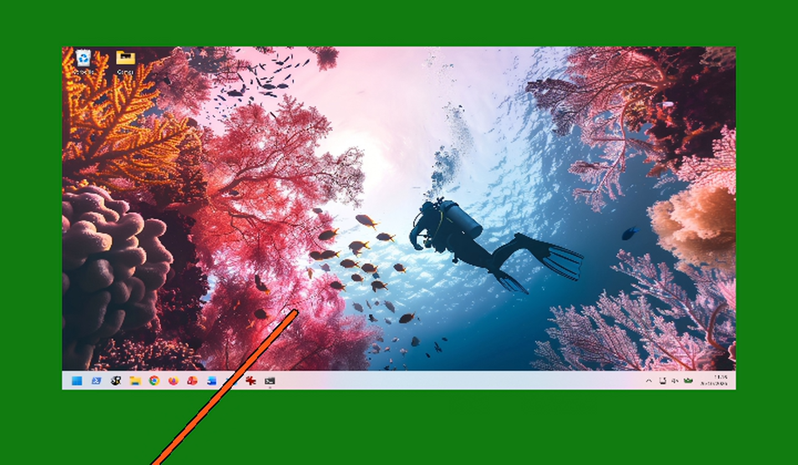

# Desktop mirror (mirrordesktop.exe)

Between games the headset shows the Windows desktop as a monitor-sized screen in front of you; the controllers are laser pointers that move the mouse.
It is **an OpenXR app like any game**, not part of the streamer engine: `bin\mirrordesktop.exe` connects through the runtime and the shim, renders a projection
layer with the views the runtime gives it, and reads the controllers through OpenXR actions. The engine treats it as a game like any other (it is recorded in the game history); the streamer turns frame generation off while it runs
(`frame_gen off`, the user's setting is restored when it ends). The shim signals `Local\AirFrameXR_GameStarting` when another app starts so the mirror leaves the headset at once. The event has an explicit security descriptor (any integrity level and account of the session may signal it; a game running elevated or not no longer matters), the mirror leaves anyway 1.5 s after the signal if the runtime keeps its session open, and the engine ends the mirror's run and starts the game's when another app takes over (the app that was told to leave does not clear the shared "alive" flag).

- **Switch it on** in the streamer window ("Between games"). The streamer starts the app while a headset is connected and no game runs, and starts it again
  after a game ends. Or run `bin\mirrordesktop.exe` by hand (`--seconds N`, `--no-mouse`, `--clear RRGGBB`, `--log file`).
- **The picture:** DXGI desktop duplication of the primary monitor (SDR, or HDR converted to SDR with Windows' SDR white level), the screen 56.5 degrees wide
  (1.6 m) at 1.5 m, a perspective-correct quad, everything else the streamer's idle colour (`video.idle_rgb` in `config\airframexr.json`, `107C10` by default: the
  headset's alpha / passthrough). The screen has one place, in front of you where you looked when it started, and it stays there (it does not follow you). A press of a grip on either controller (or End on the keyboard) puts it in front of you again; the log says `recentre`. A small "? controls" badge sits under the screen: the beam on it opens a panel with the commands (the log says "the controls hint opens"), and it closes when the beam leaves it. The text is drawn once with GDI, the card with the same shader as the screen. The capture is copied on the GPU when the screen's adapter is the
  renderer's (no round trip through the CPU).
- **The controllers:** the right controller aims (hands are not used: the clients send controllers only), the orange beam shows it. Trigger (down at 0.3, up at 0.15) = left button; A / X / B / Y = double click (Windows runs a program or opens a file on one); thumbstick up/down = scroll; grip (either controller; down above 0.7, up under 0.3) = the screen in front of you again. There is no right click. A / X / B / Y, the grips and the thumbsticks work on both controllers. Left-handed: the beam and the trigger belong to the right controller until a firm press of the left trigger (above 0.5) hands them to the left one (the log says "the left controller takes the beam"); a press on the right trigger takes them back. The press that hands the beam over does not click (it counts again once the trigger is released). If the beam's controller is not tracked, the other one is used. **Xbox pad (XInput, any connected pad, no focus needed):** either stick moves the cursor (the stronger one wins; dead zone 0.25; up to about 1600 px/s on a 1920 px screen, quadratic in the deflection; absolute moves, so no Windows pointer acceleration), A = click, B = double click, both wherever the cursor is. The pad acts like a physical mouse: the beam yields to it until a press or a sweep of the beam takes the cursor back. Built, not yet tried with a pad on a headset session; the speeds are guesses. The mouse moves over the whole virtual desktop (`MOUSEEVENTF_VIRTUALDESK`, per-monitor DPI aware), so a second monitor does not shift it.
  
 

  Left: the default, the right controller's beam. Right: after the left trigger was pressed, the left controller's beam (frames of the decoded stream of a test run through the whole chain, the left eye; `python3 harness/mirror_screenshot.py --real`).
- **A physical mouse:** if the Windows cursor is somewhere other than where the beam put it, the mouse has it: the beam stops moving the cursor and the headset's dot follows the real cursor (log: `mouse_takes`). A controller button press, or a sweep of the beam of more than 120 desktop pixels, takes it back (`beam_takes`). The dot is 8 px core and 6 px ring on a 1080-line desktop (twice the old size; the Windows pointer is not in the duplicated image, so its size setting cannot change what the headset shows).
- **Steadiness:** the pointer is smoothed (steadier when slow, immediate when fast) and held still for 12 pixels while a press starts, so a click lands where it was aimed.
- **Logs:** `logs\mirrordesktop.log` (the controller seen, the pointer reaching the screen, the aim and screen poses and the largest trigger / grip values every 5 s, every button press).
- **Update only the app:** replace `bin\mirrordesktop.exe`. Build: `build.ps1 mirrordesktop` or `python3 harness/live.py build mirrordesktop`.

Tests: `harness/mirror_check.py` (the maths in `mirror_math.h`, the picture on the GPU, a screen turned 40 degrees, the beam) and the scenarios `e2e_mirror` (the real chain with the mock client on a synthetic desktop: the idle colour
outside the screen, the screen in it, the beam in the stream, the pointer on the screen, and the timing of every scripted trigger / grip / A / B / X edge against what the
app decided, the app's frame rate and picture cost) `e2e_mirror_handover` (a game, `xr_probe`, starts while the mirror runs: the signal arrives, the mirror leaves within 2 s, the engine records the mirror's run then the game's) `e2e_mirror_handover_chain` (the field sequence: mirror, a launcher stub that lasts a second, a new mirror instance, then the real game: every mirror must leave on its signal and the engine must switch each time; `app.then` can be a list) `e2e_mirror_handover_scan` (the shim's event ignored: the mirror still leaves when another app has the runtime DLL loaded, and a mirror started over a running app waits for it) `e2e_mirror_left` (a left-handed user: the left trigger takes the beam, the app logs it and aims with the left hand) and `e2e_mirror_desktop` (the same on the real desktop, for a PC whose screen can be duplicated). Flags for
the harness: `--synthetic` (a known picture instead of the desktop, no real mouse; `--image-rgba <file>` a 1920 x 1080 raw BGRA picture instead of the grey patches, used for the README screenshot: `harness/mirror_screenshot.py`), `--input-log <csv>` (every button event with its wall-clock time).

The old design (the mirror inside `alvr_host.exe`) is the git tag `pre-mirror-app`.

Credits: the idea of absolute mouse moves over the virtual desktop and wheel events follows Immersive-2's input injector (MIT,
https://github.com/PGSCOM/Immersive); the code is our own. Desktop+ (GPL-3.0), WayVR (GPL-3.0) and DesktopXR were studied and not used.

Besides the shim's event, the mirror watches from outside: a thread looks every second for another process with `virtualdesktop-openxr.dll` loaded (the OpenXR loader loads it at `xrCreateInstance`, before any session) and leaves when it finds one; at start it waits until none is left. This covers a game that touches OpenXR early (a console or launcher stage) and opens its session later, which the one-shot event can miss. Processes that deny the module query (elevated ones) are skipped, so the event stays as the fast path.
